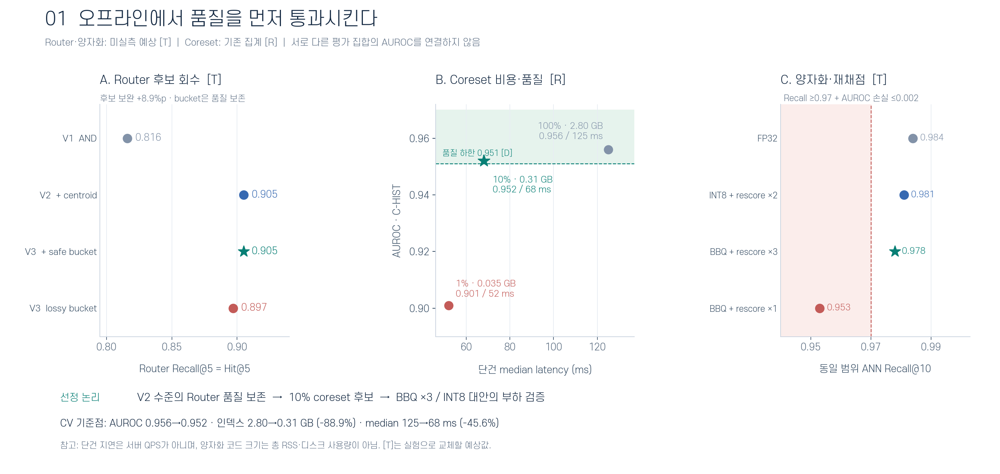
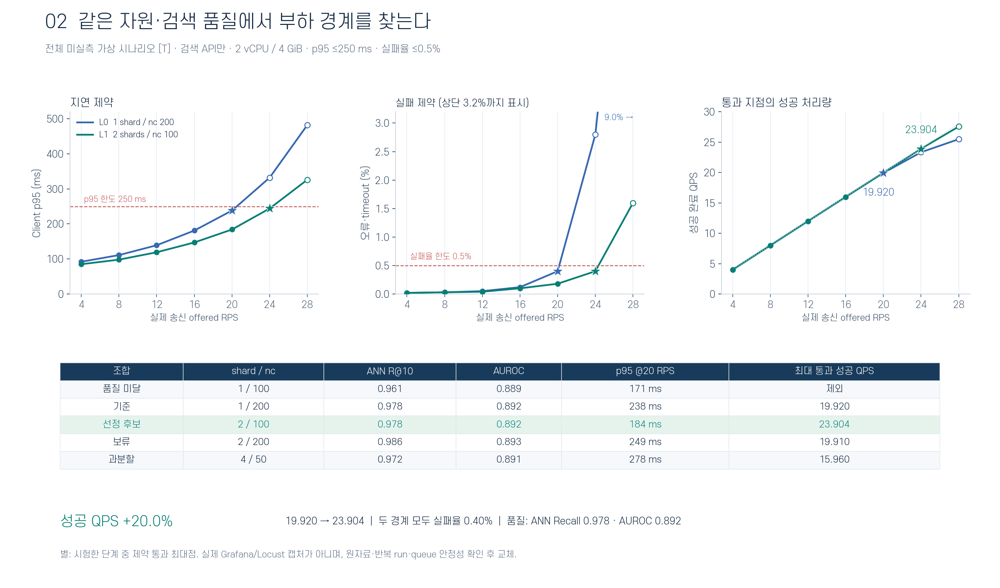
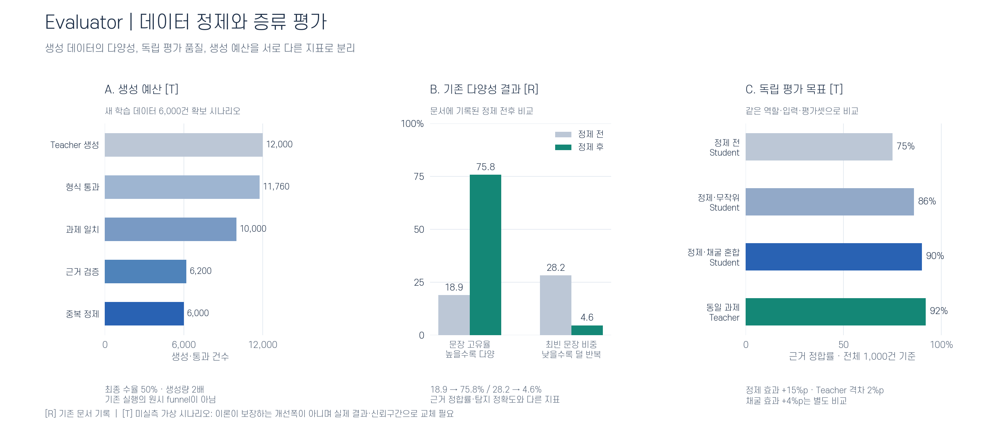
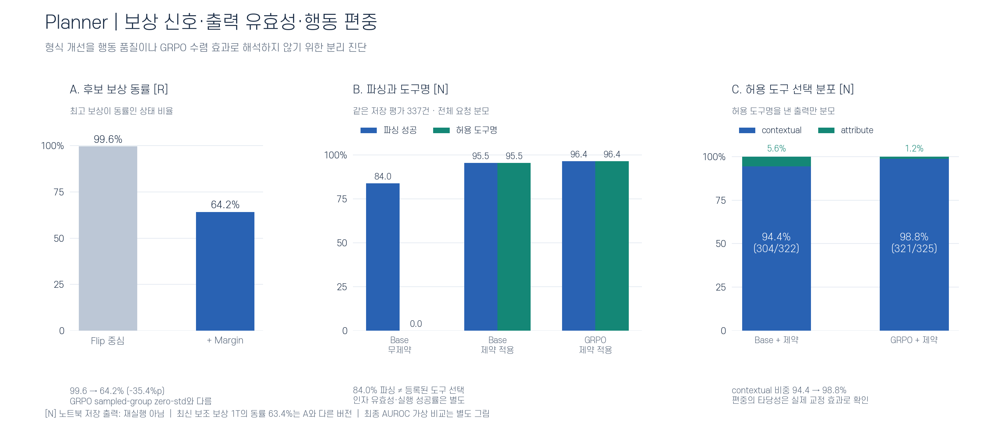
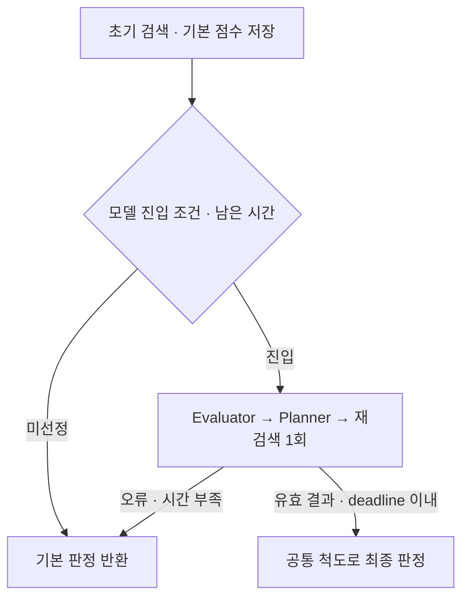

# Fraud Detection AgentRAG Pipeline

<p align="center">
  
  
  
  
  
</p>

## 📌 프로젝트 개요

**Multi-Cluster Memory Bank 이상탐지 알고리즘(EAAI 2025, 공동 1저자)을 GKE 위에서 운영 가능한 AgentRAG 시스템으로 확장한 엔드투엔드 프로젝트**입니다.

Tabular 이상 거래를 `최근접 클러스터 routing → retrieval → 거리 기반 이상탐지 → 판정 근거 설명 → 선택적 재검색` 흐름으로 처리하며, Router · Retriever · LLM Evaluator - LLM Planner · Orchestrator를 MSA로 분리해 배포했습니다.

프로젝트는 세 단계로 진행됐고, 각 단계의 결론이 다음 단계의 설계 전제가 됩니다.

| 단계 | 목표 | 결론 |
|---|---|---|
| **1. RAG 시스템 구축** | 1200만 건 정상 벡터로 구성된 memory bank를 free-tier GKE에서의 효율적 서빙 | Percolate 라우팅 + Coreset 10% + BBQ 양자화 → **메모리 −89%, AUROC 손실 0.4%p** |
| **2. RAG 시스템 보완을 위한 LLM post-training** | 이상 판정 및 검색에 LLM을 어디까지 쓸 것인가 | 서빙 제약에 따른 Qwen2.5-0.5B의 **검색 결과 판단 성능 5%p 향상**|
| **3. Agent 시스템** | 재검색 계획에 LLM이 필요한가, 그 값어치는 얼마인가 | GRPO trained plannner 기반 재검색 tool 설계로 **검색 성능 및 AUROC**  |

### 바로가기

- [1. 시스템·데이터·평가 범위](#scope)
- [2. Router–Retriever: 검색 품질과 인덱스 비용](#retrieval)
- [3. Evaluator: 실패 데이터 구축·증류·SFT](#evaluator)
- [4. Planner: GRPO와 재검색 정책 비교](#planner)
- [5. LLM 역할 분리·양자화·입력 축약](#serving)
- [6. Agent 호출 예산·부하·실패 복귀](#agent)
<!-- - [7. 결과 재현과 시각 자료](#artifacts) -->

---
<a id="scope"></a>
## 🏗️ 1️⃣ 시스템 아키텍처·데이터·평가 범위

```text
Test Transaction
      │
      ▼
[Router]       Percolate Query → 클러스터 매칭 (rank1=percolate, rank2~5=centroid)
      │
      ▼
[Retriever]    Matching cluster-Filtered HNSW (cluster-scoped, k=3)
      │
      ▼
[Evaluator]    LLM 1회
      │        └─ out: what_missing ∈ { cluster_mismatch | neighbor_insufficient | accept }
      │
      ├─ confident = nd <0.3 or nd >0.5 (60.4%)  ──→  통과 · 판단 종료
      │
      │  ambiguous = 0.3<=nd<=0.55 (39.6%)       ──→  재검색 진행
      ▼
┌─[AgentRAG Planner]─────────────────────────────────────────┐
│ Planner(LLM)  think -> tool + feature select               │  ← GRPO 학습 대상
│   └─ out: { think, tool, feature }                         │
├────────────────────────────────────────────────────────────┤
│ [Tool A] contextual_knn : dense pool expand + soft rerank  │
│ [Tool B] attribute_knn  : exact term filter                │
└────────────────────────────────────────────────────────────┘
      │
      ▼
[Orchestrator] 재검색된 정상 데이터 및 nd_final → 최종 판정 + round_log / termination
```


# Part 1. RAG 시스템 구축
> 목표는 **"1200만 건 정상 벡터로 구성된 memory bank를 free-tier GKE(e2, 메모리 2GB 제한)에서 최적화 서빙"** 입니다. 검색 축을 하나씩 sweep해 최적 운영점을 도출하고, 그 위에서 LLM 실험을 진행했습니다. 

<a id="retrieval"></a>
## 2️⃣ Router–Retriever: 오프라인 후보 선정 → 부하 검증 → exact 대조

**목적:** 정상 이웃의 검색 품질을 먼저 제한하고, 그 조건을 만족하는 구성에서 검색 API의 지속 처리량을 높입니다. 아래 순서는 기존 보고서의 **9장 R01–R02, 10–11장 R03**을 CV의 대표 수치에 맞춰 정리한 것입니다. 하이퍼파라미터 전 조합 대신 채택·기각 이유가 달라지는 후보만 비교합니다.

| 단계 | 결정할 항목 | 판단에 사용하는 자료 |
|---|---|---|
| **① 오프라인 선정** | Router version → coreset → 양자화·HNSW | 같은 요청의 검색 품질·탐지 품질, 인덱스 크기, 동시성 1의 지연 |
| **② 운영 후보 선정** | 벡터 shard × shard별 `num_candidates` | 품질 재검사 후 Locust의 실제 송신률·성공 QPS·p95·실패율 |
| **③ exact 대조·설정 고정** | global / routed exact / routed ANN | 검색 범위 손실과 ANN 근사 손실 분리, 최종 설정 manifest |

샤드는 인덱스 토폴로지 변경 항목이며 단순 런타임 파라미터가 아닙니다. `num_candidates`·rescore 범위·후보 클러스터 수도 품질에 영향을 주므로 **Locust에서만 결정하지 않고, 각 변경 뒤 오프라인 품질을 다시 확인**합니다.


### 2.1 오프라인: Router·Coreset·Quantization 후보 선정

#### A. Two-Stage Retrieval — 후보 보완과 bucket의 효과 분리

정상 임베딩의 클러스터 할당을 트리의 범위 규칙으로 표현하고, 규칙을 Elasticsearch `percolator` 필드에 등록합니다. 입력 거래를 `percolate`로 매칭한 뒤, 중복을 제거한 중심 거리 후보로 top-5 클러스터를 보완하고 그 합집합 안에서 ANN 검색을 수행합니다.

![정상 벡터에서 후보 클러스터와 최근접 이웃으로 이어지는 검색 [D]](picture/cv_20261026/router_vectors.png)

*기존 PPT 개념도 재사용. 그림의 선택적 PCA 등은 과거 설명 요소이며 이번 보정은 576차원·PCA 미적용 조건입니다.*

**기존 기록 [R]:** Strict AND 대비 중심 거리 후보 보완의 Router Recall@5 **0.816→0.905(+8.9%p)**. 이 숫자는 bucket 단독 개선으로 귀속하지 않습니다.

**이번 보정 [T]:** 기존 개선폭을 기준점으로 삼되, bucket은 **범위 규칙을 만족할 수 있는 후보를 넓게 통과시키는 term prefilter → 원래 range 조건 재검사 → 기존 순위 유지**로 설계합니다. 경계 bucket과 제한 없는 속성·결측 처리까지 포함해 실제 일치 규칙을 누락하지 않는 경우에만 V2와 같은 품질을 기대할 수 있습니다. 기존의 `tolerance ±1`·점수 혼합 구현이 자동으로 이 조건을 만족하는 것은 아닙니다.

<details>
<summary>Percolate query 형태</summary>

#### **Version 1: Strict AND**

Decision Tree의 리프 노드 경로를 `bool.filter`의 range 조건으로 직접 변환해 정밀 매칭합니다.

```python
# 예시: feature v1 ∈ [0.8, ∞) AND v3 ∈ [-1.2, ∞) → Cluster 63
{"query": {"bool": {"filter": [
    {"range": {"v1": {"gte": 0.8}}},
    {"range": {"v3": {"gte": -1.2}}}
]}}}
```

- **의도**: Decision tree leaf를 각 클러스터의 rule로 표현해 직관적으로 매칭
- **한계**: Strict AND 다수 결합으로 Top-5 매칭 다양성이 떨어짐 (같은 클러스터 1개만 매칭)

#### **Version 2: Centroid-Augmented Diversity**

Top-1 매칭 결과에 **벡터 유사도 기반 Top-4**를 추가해 다양성을 보완합니다.

```python
top_1 = percolate_strict_and(test_vec)                       # Phase 1
top_4 = sorted(centroids, key=lambda c: 1 - cos(test_vec, c))[:4]   # Phase 2
candidates = [top_1] + top_4
```

- **의도**: Recall@5 및 Top-5 다양성 ↑
- **한계**: Strict AND 대비 검색 지연 ↑

#### **Version 3: Optimized Bucketization**

Range 조건을 **Bucket index + Term filter**로 변환해 후보군 pruning을 최적화합니다. 부동소수점 range 비교를 term filter bitset 연산으로 바꾸는 것이 목적입니다.

```python
# Ingest: v1 ≤ 0.8 → bucket_3, direction="lte"
# Query : test_vec["v1"]=0.05 → bucket_3, tolerance ±1 → terms [2,3,4]
{"bool": {"must": [
    {"percolate": {"field": "query", "document": {...}}},
    {"bool": {"should": [ ... 9개 feature ... ], "minimum_should_match": 3}}
]}}
```

- **의도**: Range 비교 → Term bitset
- **한계**: Percolate index 크기 ↑, rule 수 증가 시 지연 가능성

</details>

| Router 구성 — E-TARGET, 전체 [T]¹ | Routing Acc@1 | Router Recall@5 | MRR@5 | Router 단독 p50 | 탐지 AUROC | 판단 |
|---|---:|---:|---:|---:|---:|---|
| V1: Strict AND | 0.816 | 0.816 | 0.816 | 22 ms | 0.880 | 기준선 |
| V2: V1 + 중심 거리 후보 보완 | 0.816 | **0.905** | **0.854** | 27 ms | **0.892** | 검색 품질 후보 |
| **V3-safe: V2 + 보수적 bucket prefilter·range 재검사** | **0.816** | **0.905** | **0.854** | **23 ms** | **0.892** | 구현·동등성 검증 후 채택할 후보 |
| V3-lossy: bucket 허용 폭·점수 혼합 | 0.790 | 0.897 | 0.836 | 21 ms | 0.887 | 빨라도 품질 저하로 기각 |


¹ 0.816/0.905는 과거 [R] 숫자를 재사용한 **새 평가 계약의 가상 기준점**입니다. 나머지 수치는 [T]이며 같은 holdout에서 실제 재측정한 결과가 아닙니다. V2가 기존 top-1을 보존하는 설계이므로 Acc@1도 유지했습니다. V3-safe의 27→23 ms는 예상 지연 감소로, Recall 개선과 분리합니다.

<details>
<summary>검색 지표의 정답·분모</summary>

- **Router Recall@5:** 동일 serving bank의 global exact 최근접 정상 이웃이 속한 클러스터가 후보 5개 안에 있는 요청 비율. 단일 정답 클러스터의 **Hit@5**이며, CV 명칭을 유지했습니다.
- **Routing Acc@1 / MRR@5:** 같은 정답 클러스터의 top-1 일치율 / 5위 안 reciprocal rank 평균. 누락은 0. 이 정의에서 `MRR@5 ≤ Acc@1 + (Recall@5−Acc@1)/2`입니다. 기존 표의 Acc 0.823·MRR 1.00 조합은 이 정의로 성립하지 않아 재사용하지 않았습니다.
- **ANN Recall@10:** 동일 bank·filter·distance의 exact top-10과 ANN의 교집합 비율. 분모는 `min(10, eligible_count)`이며, eligible=0은 별도 support 부족으로 집계합니다. coreset에서 삭제한 원본 ID를 ANN 누락으로 계산하지 않습니다.
- 보고서의 **global top-5 이웃이 속한 여러 클러스터의 coverage**는 위 단일 정답 Hit@5와 다른 지표입니다. 같은 `candidate_recall@5` 이름으로 섞지 않습니다.
- 본 시나리오는 진단용 `k=10`, 판정 거리 집계용 상위 이웃 `k_score=3`, 후보 클러스터 `K=5`를 구분합니다. 문서 ID 동률 처리·클러스터 할당·정규화·판정 임계값은 비교 전에 고정합니다.

</details>

#### B. Coreset·HNSW — CV의 압축·지연 기준점 보존

**C-HIST는 별도 인덱스 비교 기록**입니다. coreset 비율 외 조건을 고정한 재현 실험에서 먼저 대표성 손실을 확인하고, 같은 coreset 안에서는 exact 대비 HNSW 근사 오차를 별도로 측정해야 합니다.

| Coreset 비율 | 문서 수 | 인덱스 크기 | AUROC | 단건 median | 판단 | 상태 |
|---|---:|---:|---:|---:|---|:---:|
| 100% | 140,128 | 2.80 GB | 0.956 | 125 ms | 기준 | [R] |
| **10%** | **14,012** | **0.31 GB** | **0.952** | **68 ms** | **운영 후보** | [R] |
| 1% | 1,401 | 0.035 GB | 0.901 | 52 ms | 품질 손실로 기각 | [R] |

**CV 기준점:** AUROC 손실 **0.004**, 인덱스 크기 **−88.9% ≈ −89%**, 단건 median **−45.6% ≈ −46%**. 인덱스 크기는 디스크 저장량이며 RSS·heap·벡터 working set 감소율이 아닙니다. 원본 집계표의 상세 mapping·split·index stats·exact 실행 조건은 재현 시 복구 대상이므로, 위 값으로 양자화 효과나 end-to-end 품질까지 입증하지 않습니다.

10%를 E-TARGET에 적용하면 정상 122,810건 중 **12,281건**을 사용하는 별도 실험입니다. 위의 14,012건과 합치지 않습니다. 군집별 대표성과 희소 집단의 support를 보존하고, full bank 대비 AUROC 손실 **≤0.005**를 재확인한 뒤 후보로 유지합니다. 이 기준의 통과를 C-HIST 결과만으로 확정하지 않습니다. **재확인 예상값 [T]**은 동일 routed exact에서 100% bank **0.898**, 10% **0.894**, 1% **0.861**로 두었습니다. 이는 E-TARGET에서 재검증할 별도 가정이며 C-HIST를 환산한 실측값이 아닙니다.

| HNSW 후보 — E-TARGET, BBQ·nc=200·1 shard 고정 [T] | ANN Recall@10 | AUROC | 검색 API 단건 median | 판단 |
|---|---:|---:|---:|---|
| `m=8, ef_construction=64` | 0.962 | 0.890 | 59 ms | Recall 하한 미달 |
| **`m=16, ef_construction=100`** | **0.978** | **0.892** | **62 ms** | 품질 통과 후보 |
| `m=32, ef_construction=200` | 0.985 | 0.893 | 66 ms | 작은 품질 이득 대비 그래프·구축 비용 증가 후보 |

`m`과 `ef_construction`은 구축 설정, `num_candidates`는 검색 설정입니다. 단건 지연은 동시성 1의 측정 대상이며 `1000/median`을 서버 최대 QPS로 표시하지 않습니다.

#### C. Vector Quantization — 검색 표현과 최종 판정 점수 분리

**가설:** 양자화한 벡터로 후보를 찾고, 후보의 원벡터 거리를 재계산하면 탐색 비용을 줄이면서 점수 왜곡을 제한할 수 있습니다. 다만 원벡터 재계산은 **이미 누락한 후보를 복구하지 못하므로** Recall·AUROC·고정 임계값 성능을 함께 확인합니다.

아래는 E-TARGET의 동일 10% bank·V3-safe·HNSW(16/100)·1 shard·nc=200 조건입니다. `τ`는 validation에서 고정한 공통 임계값이며, 행마다 다시 맞추지 않습니다.

| 구성 — 전체 [T] | ANN Recall@10 | AUROC | Acc@τ | FNR@τ | 검색 API 단건 median | 판단 |
|---|---:|---:|---:|---:|---:|---|
| FP32 HNSW | 0.984 | 0.893 | 0.841 | 0.295 | 70 ms | 품질 기준 |
| INT8 + 원벡터 rescore ×2 | 0.981 | 0.892 | 0.840 | 0.300 | 65 ms | 보수적 대체 후보 |
| **BBQ + 원벡터 rescore ×3** | **0.978** | **0.892** | **0.840** | **0.300** | **62 ms** | 부하 검증 후보 |
| BBQ + 원벡터 rescore ×1 | 0.953 | 0.887 | 0.832 | 0.320 | 56 ms | 후보 부족·품질 저하로 기각 |

**통과 기준 [D]:** ANN Recall@10 **≥0.97**, 동일 FP32 대비 AUROC 손실 **≤0.002**. 최종 설정에서는 같은 검색 범위의 exact 대비 Acc@τ 손실 **≤0.005**, FNR 증가 **≤0.01**도 확인합니다. 이 값은 프로젝트의 실험 제약이며 금융 서비스의 승인 정책이 아닙니다.

576차원에서 순수 검색 코드의 크기는 FP32 **2,304 B/벡터**, INT8 **576 B**, BBQ **72 B**입니다. 이는 표현 비트 수로 계산한 값으로 **graph·보정값·원벡터·metadata·cache를 제외**합니다. Elasticsearch는 재채점을 위해 원벡터를 디스크에 보관하므로 양자화 후 총 디스크가 늘 수도 있습니다. 따라서 이전의 `working set 1/12`를 이번 bank의 확정 결과로 옮기지 않습니다. PCA는 이번 비교에서 고정·제외했습니다.[S2]



*그림 1. Router·양자화는 미실측 [T], coreset은 기존 집계 [R]입니다. C-HIST와 E-TARGET의 AUROC는 서로 다른 평가이므로 한 개선 곡선으로 연결하지 않습니다. 표의 전체 후보 조합이 아니라 채택 근거만 보여 줍니다.*

### 2.2 Locust: 품질 제약 아래 shard·검색 후보 수 선정

**고정 조건 [D/T]:** 검색 서비스 합계 **2 vCPU·4 GiB**의 통제된 실험 예산. ES 1.8 vCPU, Router/API 0.2 vCPU, GPU 없음, replica=0, rule index=1 shard 고정. 변경하는 `shard`는 **벡터 인덱스의 primary shard 수**입니다. 같은 노드 수·디스크·heap·Pod 예산에서 비교하며, load generator는 별도 실행합니다. 이는 계정의 무료 제공량이나 실제 배포 manifest를 확인한 값이 아닙니다.

BBQ·10% coreset·원벡터 rescore ×3·K=5를 고정하고, 벡터 인덱스 토폴로지를 만든 뒤 각 설정의 오프라인 품질부터 확인합니다. ES의 `num_candidates`는 **shard별** 설정입니다. 1×200과 2×100은 후보 예산의 명목 합이 같을 뿐, 방문 노드 수·CPU 비용·Recall이 같다고 보장하지 않습니다.[S1]

| 구성 — 전체 [T] | Vector shards | nc / shard | ANN Recall@10 | AUROC | p95 @20 offered RPS | 실패율 @20 | 제약 통과 최대 성공 QPS |
|---|---:|---:|---:|---:|---:|---:|---:|
| 빠른 저품질 후보 | 1 | 100 | 0.961 | 0.889 | 171 ms | 0.20% | 품질 미달·제외 |
| **L0: 기준** | **1** | **200** | **0.978** | **0.892** | **238 ms** | **0.40%** | **19.920** |
| **L1: 선정 후보** | **2** | **100** | **0.978** | **0.892** | **184 ms** | **0.18%** | **23.904** |
| 큰 후보군 | 2 | 200 | 0.986 | 0.893 | 249 ms | 0.45% | 19.910 |
| 과분할 후보 | 4 | 50 | 0.972 | 0.891 | 278 ms | 0.70% | 15.960 |

후보 수가 작아 빠른 구성도 품질이 낮으면 제외합니다. shard를 늘릴수록 유리하다고 가정하지 않으며, 4-shard 행은 작은 CPU 예산에서 fan-out·병합 부담이 커지는 **가상 실패 시나리오**입니다. 실제 CPU·queue trace 없이는 이 원인을 확정하지 않습니다.

| 최종 부하 경계 — 전체 [T] | L0 기준 | L1 선정 후보 |
|---|---:|---:|
| 실제 송신률로 설계한 offered RPS | 20 | 24 |
| 해당 부하의 클라이언트 p95 | 238 ms | 244 ms |
| 오류·타임아웃 실패율 | 0.40% | 0.40% |
| 성공 완료 QPS | **19.920** | **23.904** |
| 다음 부하 단계 | 24 RPS: 332 ms·2.80% | 28 RPS: 326 ms·1.60% |
| 판정 | 현재 단계 통과·다음 단계 탈락 | 현재 단계 통과·다음 단계 탈락 |

**CV의 +20%를 만족하는 가상 산식:** `(23.904 / 19.920 − 1) × 100 = 20.0%`. 여기서 20→24는 **offered RPS**, 19.920→23.904는 **성공 QPS**입니다. 서로 다른 부하 경계의 238→244 ms를 지연 개선으로 계산하지 않습니다. 같은 20 RPS에서는 238→184 ms(**−22.7%**)라는 별도의 예상 결과입니다.

**제약:** 검색 API client p95 **≤250 ms**, 오류·타임아웃의 합집합 **≤0.5%**, 품질 gate 유지, queue의 지속 증가 없음. request deadline은 **1초**로 고정합니다. 지연에는 네트워크·API·Router·Retriever·대기를 포함하고, 사전 임베딩 생성과 Evaluator/Planner는 제외합니다. timeout을 지연 표본에서 임의로 삭제하지 않으며, 실패율과 censored 요청을 함께 보존합니다.

**절차:** warm-up 5분 → 단계당 steady 10분 → 경계 부근 30분 유지 → 독립 run 3회. 위 표는 아직 반복 실험의 평균이 아닙니다. 실제 송신·완료 시각과 generator CPU를 저장하고, 목표 송신률을 유지하지 못한 Locust 단계는 용량 근거에서 제외합니다. `constant_throughput`은 서버가 느려도 원하는 RPS를 자동 보장하지 않습니다.[S4]



*그림 2. 실선/빈 점은 가상 부하 곡선, 별은 지연·실패 제약을 함께 통과한 최대 시험 지점입니다. 실제 Grafana 화면이나 Locust 리포트를 재현한 이미지는 아닙니다. 수학적인 최대 용량이나 실사용 트래픽 권장량이 아니라 **시험한 조합·부하 구간 내 운영 후보**입니다.*

### 2.3 Exact kNN 대조: 검색 범위 손실과 근사 손실 분리

`exact ANN`이 아니라 **exact kNN과 approximate ANN의 비교**입니다. 앞 단계의 후보는 먼저 validation에서 선정하고, 설정을 고정한 holdout에서 아래 대조를 진행합니다. ③에서 기준을 통과하지 못하면 운영 후보를 확정하지 않습니다.

**E-TARGET 공통 조건 [T]:** 정상 coreset 12,281건, 평가 10,000건(이상 2,000·정상 8,000), 같은 임베딩·원벡터 거리·스코어 변환·고정 τ. 이 비율은 가상 평가 설계이며 실제 데이터의 사기 비율이 아닙니다. routed 행은 **같은 top-5 클러스터 합집합**을 사용합니다.

| 검색 구성 — 전체 [T] | 같은 범위 ANN Recall@10 | Global exact 이웃 overlap@10 | AUROC | Acc@τ | FNR@τ | 검색 API 단건 median |
|---|---:|---:|---:|---:|---:|---:|
| Global exact, 동일 10% bank | 1.000 | 1.000 | 0.896 | 0.847 | 0.280 | 118 ms |
| Global BBQ ANN + rescore | 0.982 | 0.982 | 0.895 | 0.845 | 0.285 | 74 ms |
| Routed exact, 동일 10% bank | 1.000 | 0.704 | 0.894 | 0.842 | 0.290 | 72 ms |
| Routed FP32 ANN | 0.984 | 0.697 | 0.893 | 0.841 | 0.295 | 64 ms |
| **Routed BBQ ANN + rescore / L1** | **0.978** | **0.692** | **0.892** | **0.840** | **0.300** | **58 ms** |

같은 범위의 Recall 0.978과 global 이웃 overlap 0.692는 모순이 아닙니다. 앞 값은 **선택한 클러스터 안에서 ANN이 놓친 정도**, 뒤 값은 **전체 bank의 이웃을 라우팅이 얼마나 남겼는지까지 포함**합니다. Global exact의 Router 지표는 해당 없음이며 1.000으로 채우지 않습니다.

**판단 [T]:** Global exact→Routed exact의 AUROC **−0.002**는 검색 범위 변경, Routed exact→Routed BBQ ANN의 **−0.002**는 근사·양자화의 합산 효과입니다. Routed FP32→BBQ의 **−0.001**만 양자화 추가 효과로 해석합니다. 같은 범위 exact 대비 Acc@τ **−0.002**, FNR **+0.010**으로 설정한 상한 안에 들어가는 시나리오입니다. 원벡터 재계산이 τ 성능을 반드시 보장한다는 뜻은 아닙니다.

최종 검색 AUROC **0.892**, Acc@τ **0.840**은 뒤의 Agent 비교에서 사용하는 초기 오판 **1,600/10,000건**과 일치합니다. 예시 FN=600, FP=1,000이며, AUROC에서 이 건수를 역산한 것은 아닙니다. **C-HIST의 0.956→0.952와 이 표의 AUROC 차이는 합산하지 않습니다.**

Global ANN도 더 단순한 필수 기준선입니다. 이 시나리오에서는 74→58 ms의 단건 비용 이득과 AUROC 0.895→0.892의 손실을 함께 공개합니다. Router 구조가 모든 데이터에서 우월하거나, 이 비교만으로 LLM 재검색의 비용이 정당화됐다고 주장하지 않습니다. Agent의 추가 효과는 4절의 동일 요청 정책 비교로 검증합니다.

**최종 운영 후보 [T]:** 중심 거리 후보 보완 + 품질 보존형 bucket prefilter, 10% coreset, BBQ·원벡터 rescore ×3, HNSW(16/100), vector shard=2, `num_candidates=100/shard`, K=5. 검색 API p95≤250 ms·실패율≤0.5% 아래 성공 QPS **19.920→23.904(+20%)**를 목표로 하며, 실제 run에서 품질·지연·오류 중 하나라도 미달하면 INT8/FP32 또는 이전 설정으로 돌아갑니다.

### 2.4 Locust·Prometheus·Grafana에서 남길 최소 증거

UI 캡처 자체가 성능 증거는 아닙니다. **동일 run_id·설정·시간 구간의 원자료**가 필수이고, 화면은 그 요약으로 사용합니다. 추가 개념 그림 없이 아래 3개 묶음이면 본문의 운영 결론을 설명할 수 있습니다.

| 자료 | 반드시 표시할 항목 | 무엇을 확인하는가 |
|---|---|---|
| **Locust 결과·CSV** | 실제 issued RPS, success QPS, client p95/p99, 오류·timeout, 단계 경계·run ID | +20%의 분모와 제약을 동시에 확인 |
| **Grafana 자원·병목 화면 1장** | CPU usage/limit·throttled-period 비율, ES queue/reject, RSS/heap·file cache, 같은 구간의 API p95 | CPU·대기·메모리 중 어떤 병목을 개선했는지 진단 |
| **품질 replay 결과 표** | request ID별 이웃·거리·인덱스 버전, scoped ANN Recall·AUROC·Acc/FNR, 응답 coverage | 부하 때문에 품질이 낮아지거나 실패한 요청이 숨겨지지 않았는지 확인 |

성공 응답의 AUROC와 응답 coverage를 함께 보고하며, 실패 요청에 임의의 이상 점수를 넣어 AUROC를 만들지 않습니다. 필요하면 응답 실패의 이웃 Recall을 0으로 처리한 **delivered recall**도 별도 집계합니다. 예를 들어 응답 성공률 99.6%와 성공 응답 Recall 0.978이면 delivered recall은 약 **0.974**인 예상 시나리오입니다.

기존 Grafana 설정에서 `retriever_es_index_store_bytes`는 **디스크 사용량**이므로 `index working set`으로 표시하지 않습니다. API 프로세스의 page fault를 원격 ES의 page-cache miss로 해석하지 않으며, page fault와 p95의 동시 상승만으로 인과를 확정하지 않습니다. 이번 작은 bank에서는 major fault가 거의 없을 수 있으므로 **page-fault 그림을 필수 핵심 증거로 강제하지 않습니다.**

> 실제 교체가 필요한 자료: 최신 설정의 Locust 원자료·리포트, 위 3행에 해당하는 Grafana/품질 replay 자료. 기존 PPT 화면은 배포·계측 구현 예시로만 유지합니다. 상세 보정 근거와 수집 계약은 [보정·계측 노트](notes/RETRIEVAL_CALIBRATION.md), 모든 그림의 집계 입력은 [보정 데이터](data/retrieval_calibration.json)에 있습니다.


# Part 2. LLM post-training(Evaluator & Planner)

> 목표는 **"이상 판정에 LLM을 어디까지 쓸 것인가"** 를 단계별 측정으로 정하는 것입니다. 검색 실패 상태를 학습 데이터로 구성해 Evaluator를 증류·SFT하고, 재검색 결과를 보상으로 Planner를 학습합니다. 역할 분리·양자화·호출 비용은 Part 3에서 다룹니다.

**수치 구분:** [R] 기존 README·CV에 기록된 결과(원시 로그 재현 전), [N] 업로드 노트북의 저장 출력, [T] 미실측 가상 보정 시나리오, [D] 개념 예시. **[T]는 CV와의 산술·평가 조건 일관성을 맞춘 실험 목표이며, 이론이 보장하는 성능이나 실제 측정 결과가 아닙니다.** [상세 보정 근거](notes/PART2_CALIBRATION.md)

<a id="evaluator"></a>
## 3️⃣ Evaluator: 실패 데이터 구축·증류·SFT

### 3.1 Pipeline-aware Hard Negative Mining

**문제:** 일반적인 거래 설명 학습만으로는 검색 근거가 왜 부족한지 진단하기 어려움.  
**접근:** 기존 검색이 정상 이웃을 놓치거나 부적절한 비교 집단을 반환하는 상태를 중심으로 학습 데이터 구성. 여기서 hard negative는 사기 거래 자체나 대조학습의 음성 쌍이 아니라 **검색·진단 과제의 어려운 상태**를 의미합니다.

![검색 실패 후보를 채굴하는 세 유형 [D]](picture/cv_20261026/mining_types.png)

| 패턴 | 수집·확인 기준 | 학습에 사용하는 정보 |
|---|---|---|
| **Router 오배정** | 기준 클러스터가 실제 검색한 top-5 클러스터 합집합에서 제외되는지 확인 | 검색 범위 밖 정상 이웃의 누락 |
| **Cross-Cluster / 후보 누락** | top-1 불일치를 수집 태그로 사용하되, 같은 검색 범위의 exact kNN과 비교해 실제 이웃 누락·비교 집단 차이 확인 | 라우팅 오류와 ANN 후보 부족을 구분한 근거 |
| **Distance boundary** | 검증셋에서 정한 임계값 근처의 요청 수집 | 작은 이웃·거리 변화에 판정이 민감한 상태 |

그림의 top-1 불일치·GT-in-top-5는 **후보 수집 조건**입니다. 현재 검색은 top-5 클러스터를 함께 조회하므로, 이 조건만으로 실패나 재검색 복구 가능성을 확정하지 않습니다. 기준 클러스터·이웃은 학습용 정상 메모리 뱅크의 비교 기준이며 사기 정답 라벨과 구분합니다. 유형은 중복될 수 있고, 정상적으로 검색된 사례와 `accept` 사례도 함께 학습합니다.

### 3.2 Teacher Distillation·Rejection Sampling

**초기 실패:** 정답을 먼저 제시한 Teacher의 설명이 반복되고 결론을 따라가는 경향 관찰.  
**개선:** Teacher 입력에서 정답을 제외하고 거래·검색 근거만 제공한 뒤, 생성 결과의 과제 일치·근거 사실성·중복을 검사. 정제한 Qwen2.5-14B 진단 문장을 Qwen2.5-0.5B의 LoRA SFT 정답으로 사용하는 **응답 증류(sequence-level distillation)** 적용.

![Teacher 생성, 데이터 정제, Student SFT 흐름 [D]](picture/cv_20261026/distillation_flow.png)

<details>
<summary>Prompt 및 데이터 정제 과정</summary>

#### **Version 1: GT-conditioned 생성 (rejection 없음)**

```text
[거래·정상 이웃의 속성 및 통계] + GROUND TRUTH: ABNORMAL
→ 정답을 이미 알고 있는 Teacher가 설명 생성
```

- **의도:** 라벨과 설명의 일관성 확보.
- **관찰 [R]:** 문장 고유율 18.9%, 최빈 문장 비중 28.2%. 반복 표현과 사후 합리화 위험을 확인했지만, 이 두 수치만으로 Student의 암기나 인과적 실패를 입증하지는 않음.

#### **Version 2: Prompt v2 + GT-free 생성 → 3중 Rejection**

**"통계는 시스템이 계산하고, 해석만 LLM에 남긴다"** — z-score·이웃 합의를 미리 계산해 입력하고, 생성 단계에서 정답을 감춘 뒤 학습 데이터만 사후 검증합니다.

```text
[Deviation Table] age: z=-2.31 [DEVIANT], purchase_value: z=+0.79 [ok]
[Retrieval digest] agrees: sex(3/3) | differs: browser(1/3)
→ {"what_missing": "<type>: <입력에서 확인 가능한 근거>"}
```

위 숫자는 입력 형식 설명용 [D]입니다. 평가셋은 Teacher가 맞히거나 rejection을 통과한 요청으로 제한하지 않습니다. 정답 라벨은 학습 데이터 검사에만 사용하며 실제 추론 입력에서는 제외합니다.

</details>

| 필터 | 내용 | 해결하려는 실패 모드 |
|---|---|---|
| ① 라벨·과제 일치 | 초기 다중 출력의 보조 `cls`는 학습 GT와 비교. 최종 진단은 별도 정의한 유형·근거 기준으로 검사 | 사기 라벨과 진단 유형을 혼동하거나 모순된 학습 목표를 만드는 문제 |
| ② grounded | 인용 속성의 존재, 수치·방향·서술의 일치 검사 | 속성명만 언급하고 실제 근거와 반대로 설명하는 문제 |
| ③ dedup cap | 동일한 정규화 키로 반복 문장 집계·제한. 새 실험은 최종 코퍼스 기준 상한 5% [T] 적용 | 소수 문장이 학습 데이터를 지배하는 문제 |

그림의 `cls-GT` 단계는 보조 판정이 있던 생성 버전에 해당합니다. **사기 정답만으로 `cluster_mismatch`·`neighbor_insufficient`의 정답을 만들지는 않습니다.** 기존 문서의 키당 2% 제한과 최빈 문장 4.6%는 집계 분모·키가 확인되지 않아 같은 실험의 결과로 연결하지 않았습니다.

| 생성 데이터 지표 | 정제 전 | 정제 후 | 변화 | 상태 |
|---|---:|---:|---:|:---:|
| 문장 고유율 | 18.9% | **75.8%** | +56.9%p | [R] |
| 최빈 문장 비중 | 28.2% | **4.6%** | −23.6%p | [R] |

두 지표는 **생성 데이터의 다양성**이며 근거 정합률·이상탐지 정확도가 아닙니다. 아래 가상 funnel은 새 학습 데이터 6,000건 확보를 위한 생성 예산 예시입니다. 생성 12,000 → 형식 통과 11,760 → 과제 일치 10,000 → 근거 검증 6,200 → 중복 정제 6,000건 [T], 전체 수율 50%. 기존 실험의 원시 단계별 건수를 복원한 값은 아닙니다.

### 3.3 과제 특화 평가 — 무엇을 진단했는가

Evaluator는 거래·정상 이웃의 속성 차이와 통계를 읽고 **cluster_mismatch / neighbor_insufficient / accept** 유형과 근거 문장을 출력합니다. 진단은 재검색 선택을 위한 가설이며, 검색 오류의 확정 라벨로 사용하지 않습니다.

![코드 계산 근거와 단일 진단 출력 [D]](picture/cv_20261026/evaluator_evidence.png)

**근거 정합률:** 전체 평가 요청 중 필요한 근거를 제시하고, 인용한 속성·수치·방향이 입력 근거와 일치하는 응답의 비율. 빈 출력·파싱 실패·필수 근거 누락·상충하는 서술은 실패로 포함합니다. `accept`에도 근거와 모순 없는 충분성 설명을 요구하며, Teacher와 같은 문구를 써야 통과하는 기준은 사용하지 않습니다.

**공통 조건 [T]:** 학습·정제와 분리한 독립 평가 1,000건. 어려운 사례뿐 아니라 정상 검색·`accept` 사례를 포함하고, Teacher와 독립된 근거 기준으로 평가합니다. Student 비교는 모델·입출력 역할·학습 표본 수·학습량을 동일하게 고정합니다.

| 동일 독립 평가 조건 | 통과 / 전체 | 근거 정합률 | 비교 목적 | 상태 |
|---|---:|---:|---|:---:|
| 0.5B Student, 정제 전 데이터 SFT | 750 / 1,000 | 75% | 데이터 정제 전 기준선 | [T] |
| **0.5B Student, 정제 후 데이터 SFT** | **900 / 1,000** | **90%** | 동일 역할에서 정제 효과 +15%p | [T] |
| Qwen2.5-14B Teacher, 동일 진단 과제 | 920 / 1,000 | 92% | Student 품질 손실 2%p | [T] |



**채굴 효과의 별도 비교 [T]:** 동일하게 정제한 무작위 학습 데이터의 Student 86% → 실패 채굴+무작위 혼합 Student 90%. 정제 전후 75→90%와 다른 비교이며, 두 개선폭을 합산하지 않습니다. 이 86%는 채굴 효과를 확인할 비교군의 가상값으로, Teacher 성능이나 기존 수치에서 계산한 값은 아닙니다.

<details>
<summary>기존 평가 결과의 활용 범위 — 97.5%·100%와 독립 평가 90%의 차이</summary>

| 기존 README의 평가 | 결과 | 이번 문서에서의 사용 |
|---|---|---|
| S5, 별도 158건의 유형 정확도 | 154/158 = 97.5% [R] | 해당 표본·유형 정의에서의 결과로 보존 |
| 같은 평가의 P1 근거 일치 / 존재하지 않는 feature 인용 | 100% / 0건 [R] | 제한된 사실 방향 검사 결과. 독립 평가 90%와 직접 비교하지 않음 |
| evidence axes F1 / Teacher 표현 Jaccard | 0.869 / 0.579 [R] | 근거 축 선택과 문구 일치가 서로 다른 평가임을 확인 |
| 기존 Evaluator SFT → SFT+GRPO 비교 | 유형 정확도 0.980→0.980, axes F1 0.899→0.886 [R] | 해당 조건에서 RL 추가 이득이 확인되지 않아 SFT를 기본 후보로 유지 |

기존 작은 평가셋의 높은 값으로 과제의 이론적 상한이나 일반화를 주장하지 않습니다. 배포 후보의 이전 88% 평가는 n=100·양자화 등 조건이 달라, 여기의 독립 1,000건·90% 목표와 분리합니다.

</details>

**결론:** 검증 가능한 진단 과제로 범위를 좁히고 데이터 정제·증류의 효과를 평가합니다. 0.5B의 90%·Teacher의 92%는 CV와 맞춘 가상 목표이며, 실제 신뢰구간과 비용 우위는 독립 평가·서빙 측정으로 확정합니다. 근거 정합률을 재검색 성공률이나 최종 AUROC로 대체하지 않습니다.

<a id="planner"></a>
## 4️⃣ Planner: GRPO와 재검색 정책 비교

### 4.1 ReAct 기반 판단 근거·행동 생성

**문제:** 검색 결과와 Evaluator 진단을 종합해 어떤 재검색이 판정을 개선할지 선택해야 함.  
**접근:** Observation(검색 근거·진단) → think(짧은 판단 근거) → Action(도구·속성) → 새 Observation(이웃·거리)의 1-step Planner 설계. SFT의 출력 모방을 넘어 **재검색 후 판정 결과**를 학습하도록 GRPO 적용. 도구 호출 후 코드가 최종 점수·판정을 다시 계산합니다.

![검색 관측에서 판단 근거와 도구 선택으로 이어지는 Planner [D]](picture/cv_20261026/planner_action.png)

| 도구 | 검색 동작 | 확인할 한계 |
|---|---|---|
| contextual_knn | Dense 후보 집합 안에서 선택 속성에 따른 soft reranking | 후보 밖 정상 이웃을 자동으로 회수하지 못함 |
| attribute_knn | 선택 속성의 조건으로 비교 집단을 제한한 뒤 최근접 검색 | 작은 support·zero-hit·잘못된 필터로 정상 이웃 누락 가능 |

도구의 속성 값은 원본 거래에서 조회하고 허용된 속성만 실행합니다. MCP는 입력·출력 계약과 호출을 연결하며 올바른 선택이나 탐지 개선을 보장하지 않습니다. **진단 유형을 특정 도구에 무조건 매핑하지 않고** 실제 재검색 결과로 평가합니다. 그림의 선택은 한 사례의 설명이며, `think`의 자연스러움만으로 올바른 행동이나 충실한 내부 추론을 입증하지 않습니다.

### 4.2 GRPO Post-training — 형식이 아닌 행동 결과 최적화

같은 검색 상태에서 여러 출력을 생성하고 재검색 결과의 상대 보상으로 정책을 업데이트합니다. 현재 저장 노트북은 **Qwen2.5-0.5B-Instruct에서 시작한 GRPO_ONLY** 실험입니다. 4.4의 SFT Planner는 별도 비교군이며 SFT→GRPO 순차 학습 결과로 해석하지 않습니다.

| 보상 요소 | 의도 | 검증할 점 |
|---|---|---|
| 오판→정답 교정 보상 / 정답→오답 전환 감점 | 실제 판정 개선 유도 | 교정 수와 새로 만든 오류를 함께 집계 |
| 정답 방향 점수 margin 개선 | 판정이 유지되는 상태에도 보상 차이 제공 | 점수 정규화·계수에 따라 교정 보상을 압도하지 않는지 확인 |
| 도구별 보조 신호 | 노트북의 spread 감소·cluster escape를 보조 정보로 사용 | 분산 감소·클러스터 변경 자체가 올바른 판정은 아니므로 독립 성과로 주장하지 않음 |

**희소 보상 진단 [R]:** flip 중심 보상에 margin을 추가한 기존 후보 비교에서 보상 동률 비율 **99.6%→64.2%(−35.4%p)**. 같은 상태의 후보 중 최고 보상이 동률인 비율이며, 실제 GRPO sampling group의 reward 표준편차가 0인 비율과는 다릅니다. 후자는 학습 중 별도 기록해야 합니다. 최신 저장 노트북의 보조 보상 포함 `1T` 설정은 **63.4% [N]**로, 64.2%와 다른 버전의 결과입니다.

정답 라벨은 학습 보상·평가에만 사용하고 Planner 입력과 실행 시 후보 제한에서는 제외합니다. CV의 동률 감소는 보상 설계 진단이며, 학습 수렴 속도나 최종 AUROC 개선을 직접 뜻하지 않습니다.

### 4.3 Constrained Decoding — 출력 유효성과 학습 효과 분리

think의 자유 생성은 유지하고 도구명·인자의 허용 범위를 제한해 유효한 행동을 탐색하도록 구성합니다. 형식 제약으로 줄인 실패와 GRPO가 바꾼 행동 선택을 분리합니다.

| 동일 저장 평가 n=337 | 출력 제약 | 파싱 성공률 | 허용 도구명 비율¹ | 상태 |
|---|---|---:|---:|:---:|
| Base Qwen2.5-0.5B-Instruct | 없음 | 283/337 = **84.0%** | 0/337 = 0.0% | [N] |
| 동일 Base | 적용 | 322/337 = **95.5%** | 322/337 = 95.5% | [N] |
| GRPO 모델 | 적용 | 325/337 = **96.4%** | 325/337 = 96.4% | [N] |

¹ 저장 출력에서 `contextual_knn`·`attribute_knn`과 정확히 일치하는 도구명을 집계. 무제약 모델의 자연어 action은 파싱되더라도 등록된 도구명이 아니었습니다. **이 표는 인자·전체 schema 유효율 또는 도구 실행 성공률이 아닙니다.**



**남은 실패 모드:** 허용 도구명을 낸 출력 중 contextual 선택은 Base **304/322(94.4%) → GRPO 321/325(98.8%) [N]**. 편중 자체로 오답이라고 판단하지 않지만, 파싱 개선을 행동 다양성·품질 개선으로 해석할 수는 없습니다. 속성 support·초기 진단별 실제 교정 효과를 함께 확인합니다.

<details>
<summary>think 평가와 학습 구현 점검</summary>

- **저장된 약식 평가 [N]:** 별도 n=120에서 입력 태그·feature를 함께 언급한 출력 6건(5.0%). 이 검사는 수치·방향·도구 선택의 타당성을 모두 검증하지 않으므로 의미적 정합률이 아닙니다.
- **CV 연계 목표 [T]:** 독립 1,000건에서 필수 근거의 사실성, 관측과 설명의 모순 여부, 설명과 선택 행동의 연결을 함께 평가해 920건 통과(근거–행동 정합률 92%)를 목표로 설정. 5.0%에서 92%로 개선됐다는 의미가 아니며, 선택한 도구가 실제로 판정을 개선하는지는 4.4에서 별도 평가.
- **구현 점검:** 생성 시 토큰 제약 적용만으로 GRPO 학습의 정합성이 보장되지 않음. 제한한 샘플링 분포와 학습에 사용한 정책 log-probability·importance ratio의 일치 확인 필요. 현재 코드에서 생성 제약은 확인되지만, 같은 mask를 반영한 확률 계산까지 검증됐다고 주장하지 않음.

</details>

### 4.4 Controlled Evaluation — LLM 정책의 추가 가치

**공통 조건 [T]:** 10,000건, 같은 초기 검색 결과·도구 집합·최대 재검색 1회·고정 판정 임계값. LLM 정책의 출력 제약은 동일하게 적용합니다. GBDT는 사기 분류기가 아니라 **재검색 행동 선택 기준선**이며, 공통 입력에서 추출한 수치·범주형 특징으로 행동을 선택합니다.

학습·검증·평가의 거래 및 중복 그룹을 분리하고, 거리 점수의 정의·정규화를 공통으로 고정합니다. 임계값과 모델 선택은 검증셋에서 확정하며 평가셋에서 다시 맞추지 않습니다. 파싱·도구 실패 요청도 제외하지 않고 기본 검색 판정으로 복귀한 결과를 집계합니다. **전수 재검색은 전체 요청에 모델 경로를 적용하는 비교 조건으로, 모든 호출의 성공을 뜻하지 않습니다.**

| 정책 | 전체 AUROC | 오판→정답 | 정답→오판 | 순교정률¹ | 최종 오판 | 상태 |
|---|---:|---:|---:|---:|---:|:---:|
| 검색 단독 | 0.892 | — | — | — | 1,600 | [T] |
| 고정 재검색 도구 | 0.905 | 150 | 50 | 1.0% | 1,500 | [T] |
| GBDT 정책, LLM 진단 없음 | 0.910 | 235 | 65 | 1.7% | 1,430 | [T] |
| 공통 Evaluator + GBDT | 0.914 | 280 | 60 | 2.2% | 1,380 | [T] |
| 공통 Evaluator + SFT Planner | 0.918 | 300 | 60 | 2.4% | 1,360 | [T] |
| **공통 Evaluator + GRPO Planner, 전수 재검색** | **0.925** | **380** | **60** | **3.2%** | **1,280** | **[T]** |

¹ 순교정률 = (오판→정답 − 정답→오판) / 전체 10,000건. 최종 오판 = 1,600 − 교정 + 신규 오판. 모든 전환은 **동일한 초기 검색 판정**을 기준으로 계산합니다. ‘각 60건’은 집계 건수가 같다는 뜻이며 같은 사례라는 의미가 아닙니다.

![재검색 정책별 AUROC와 판정 전환 비교 — 미실측 가상 보정 시나리오 [T]](picture/cv_20261026/policy_comparison_target.png)

**결과 해석 [T]**

- **전체 보강 파이프라인:** 검색 단독 대비 전수 GRPO AUROC **0.892→0.925(+0.033)**. 이 전체 효과를 GRPO 단독 학습의 기여로 표시하지 않음.
- **정책 학습 비교:** 공통 Evaluator에서 SFT 대비 GRPO AUROC **+0.007**, 순교정률 **2.4%→3.2%(+0.8%p)**.
- **단순 기준선 대비:** 공통 Evaluator+GBDT 대비 GRPO AUROC **+0.011**, 최종 오판 **1,380→1,280건(100건 감소)**.

이 비교는 서로 다른 정책의 품질을 비교하는 시나리오입니다. 동일 계산 비용의 우위나 통계적 유의성을 주장하지 않으며, 반복 학습·동일 요청의 paired 비교·표본 의존성을 반영한 신뢰구간으로 확정합니다. **AUROC에서 교정 건수를 역산하거나 1−AUROC를 거래 오판율로 사용하지 않습니다.** 운영 호출 예산과 비용 비교는 Part 3의 별도 실험으로 유지합니다.

# Part 3. Agent 시스템

> 목표는 **검색·진단 품질을 유지하면서 모델 추론 비용과 호출 범위를 줄이고, 실패를 포함한 실제 응답 품질까지 검증하는 것**입니다. 역할 분리 → 양자화·입력 축약 → 선택 호출 → 부하·실패 복귀 순으로 비교합니다.

**수치 구분:** [R] 기존 문서 기록, [N] 노트북 저장 출력, [C] 업로드 코드에서 확인한 구현, [T] 미실측 가상 목표·예시, [D] 설계 설명. **[T]의 방향과 산술을 검토했지만 실제 성능을 보장하지 않습니다.** 전체 CV 항목별 근거·제약은 [CV 수치 연결 검토](notes/CV_METRIC_RATIONALE.md), 운영 계측 보완은 [Part 3 검증 근거](notes/PART3_CALIBRATION.md)에 정리했습니다.

<a id="serving"></a>
## 5️⃣ LLM 역할 분리·양자화·입력 축약

### 5.1 Deterministic–LLM 역할 분리

**문제:** CPU 서빙에 적합한 소형 모델이 이상 판정·충분성·근거 서술을 동시에 수행할 때 판정 품질 저하.  
**결정:** 거리 점수·임계값 판정·진입 조건은 코드로 분리하고, LLM에는 검색 근거 진단을 유지. 역할 축소 후 3B 후보 대신 0.5B Student의 진단 품질을 평가합니다.

| 기존 역할 검증: 전체 300건 중 불확실 158건 | 판정 정확도 | 상태 |
|---|---:|:---:|
| LLM 직접 판정 | 0.703 | [R] |
| 거리 기반 코드 판정 | **0.791** | [R] |

| 역할 | 변경 전 | 변경 후 |
|---|---|---|
| 최종 이상 판정 | LLM이 판정·근거 함께 생성 | 검색 점수와 고정 임계값으로 계산 |
| 근거 부족 진단 | 판정과 함께 학습 | 0.5B Evaluator가 유형·근거 출력 |
| 추가 검색 | 진단을 설명으로만 사용 | Planner가 도구·속성 선택, 실행 후 점수 재계산 |

정확도 0.703→0.791은 **불확실 부분집합의 판정 담당을 바꾸는 근거**입니다. 모델 축소의 효과나 독립 근거 정합률 90%를 입증하는 실험은 아니며, 3B→0.5B만으로 속도 향상 배수를 계산하지 않습니다. ‘3역할→1개 진단 출력’은 과제 분리를 뜻하며 과거 버전별 JSON 필드 수와 구분합니다.

**점수 계약:** 초기 검색·재검색·fallback에 같은 거리 정의·정규화·임계값을 적용합니다. 현재 Controller의 재검색 전용 reweighting은 초기 점수와 척도를 바꿀 수 있으므로, 아래 공통 비교에서는 비활성화하거나 검증셋에서 정한 공통 점수 변환을 별도로 검증해야 합니다. 검색 후 `nd`가 작아졌다는 이유만으로 정상 판정이 개선됐다고 보지 않습니다.

### 5.2 Quantization·Prompt Compression

**접근:** 학습 adapter 병합 후 GGUF 변환·가중치 양자화, 검색 원시 덤프를 사전 계산한 통계·속성 편차·이웃 합의 digest로 축약. GGUF는 파일 형식이며, 경량화 효과는 실제 양자화 방식·커널·입출력 길이에 따라 달라집니다.

**공통 비교 [T]:** 동일 0.5B 모델·adapter·CPU 자원·동시성·cache 조건, 고정 요청 1,000건. HF↔GGUF 변환의 출력 정합을 먼저 확인하고, 같은 GGUF backend의 비양자화 기준과 비교합니다. 빈 출력·파싱 실패·fallback도 품질 평가 분모에 포함합니다.

| 서빙 구성 | Evaluator 근거 정합률 | Planner 근거–행동 정합률¹ | 모델 경로 평균 CPU초/요청 | 기준 대비 | 상태 |
|---|---:|---:|---:|---:|:---:|
| 비양자화·원시 입력 | 90.0% | 92.0% | 4.80 | 기준 | [T] |
| 가중치 양자화만 적용 | 89.8% | 91.8% | 4.36 | −9.2% | [T] |
| 입력 digest만 적용 | 90.3% | 92.3% | 4.16 | −13.3% | [T] |
| **양자화 + 입력 digest** | **90.0%** | **92.0%** | **3.84** | **−20.0%** | **[T]** |

¹ Part 2의 독립 의미 평가 기준입니다. 자연스러운 설명이나 JSON 파싱만으로 통과시키지 않으며, 최적 도구 선택·최종 판정 교정과도 다른 지표입니다. **현재 업로드된 `local_planner.py`의 제약 출력은 action/features 중심으로, 자유로운 think 생성 경로와 같지 않습니다.** 92%·CPU 비교는 동일한 `think+action` 계약을 학습·서빙에 연결한 뒤 검증할 목표입니다. action-only 모델의 더 짧은 출력을 같은 품질의 비용 절감으로 계산하지 않습니다.

![양자화·입력 축약의 품질–CPU 비용 가상 비교 [T]](picture/cv_20261026/cpu_quality_target.png)

**보정 근거:** 양자화는 가중치 읽기·연산 비용을, 입력 축약은 주로 입력 처리량을 줄일 수 있습니다. 효과가 겹치므로 두 개선율을 더하지 않습니다. 표의 양자화 단독 품질 하락과 digest의 보완 효과도 가정이며, 실제 비열등성은 paired 평가로 확인합니다. 4.80→3.84 CPU초는 기존 **1.00→0.80 목표를 설명하기 위한 절대값 예시**이지 하드웨어 이론에서 계산한 실측 예측값은 아닙니다.

**프로파일링:** 입력 처리·출력 생성·형식 처리를 구분합니다. 가상 분해는 `3.05+1.55+0.20=4.80 → 2.30+1.36+0.18=3.84 CPU초`입니다. 실제로는 단계별 process CPU와 wall-clock 시간을 각각 수집하고, 병렬 요청의 process CPU 구간을 중복 합산하지 않습니다. 운영 총 CPU는 Evaluator·Planner 컨테이너의 누적 사용량과 종료 요청 수로 계산하며 실패·재시도·취소 후 잔여 실행도 포함합니다.

대기 시간은 지연에 포함하지만 CPU 시간과 같은 항이 아닙니다. **CPU 20% 감소를 응답 지연·클라우드 청구액 20% 감소로 바꾸지 않습니다.** TTFT도 순수 prefill CPU 시간이 아니며, streaming chunk 개수를 출력 token 수로 간주하지 않습니다. warm/cold·실제 cache hit·출력 길이·최대 생성 길이를 비교 조건으로 남깁니다.

<a id="agent"></a>
## 6️⃣ Agent 호출 예산·부하·실패 복귀

### 6.1 Quality-constrained Budgeting — 전체 품질을 유지하는 선택 호출

**목표:** 전수 모델 경로 대비 전체 AUROC 손실≤0.002 조건에서 호출 수 축소. 초기 검색 점수의 불확실성으로 **Evaluator 이전에** 진입을 결정하고, 재검색은 최대 1회로 제한합니다. 진입 임계값은 검증셋에서 고정하며 테스트 정답을 보고 교정 가능한 요청을 고르지 않습니다.



| 동일 전체 10,000건의 오프라인 replay | 모델 진입률 | 전체 AUROC | 최종 오판 | 검색 단독 대비 순교정 | 상태 |
|---|---:|---:|---:|---:|:---:|
| 검색 단독 | 0% | 0.892 | 1,600 | — | [T] |
| **선택 호출 운영 후보** | **40%** | **0.923** | **1,300** | **300건, 3.0%** | **[T]** |
| GRPO 전수 모델 경로 | 100% | 0.925 | 1,280 | 320건, 3.2% | [T] |

![모델 진입률별 전체 품질과 오판 수 — 가상 보정 시나리오 [T]](picture/cv_20261026/budget_target.png)

그림은 0%·40%·100%의 세 조건입니다. 그 사이의 최적 예산을 탐색한 곡선은 아닙니다. 40%는 이 평가 시나리오의 관측 비율이며 고정 진입 임계값이 모든 트래픽에서 정확히 40%를 만든다는 뜻은 아닙니다.

| 선택 호출 정책의 구간 | 요청 수 | 초기 오판 | 오판→정답 | 정답→오판 | 최종 오판 | 상태 |
|---|---:|---:|---:|---:|---:|:---:|
| 모델 진입 | 4,000 | 1,300 | 350 | 50 | **1,000** | [T] |
| 미진입 | 6,000 | 300 | 0 | 0 | 300 | [T] |
| **전체** | **10,000** | **1,600** | **350** | **50** | **1,300** | **[T]** |

**산술 연결:** 선택 구간 오판 **1,300→1,000(−23.1%)**, 전체 오판 **1,600→1,300(−18.8%)**. 전수 호출은 미선정 6,000건에서 30건 교정·10건 악화를 추가하는 가정이므로 Part 2의 **380건 교정·60건 악화·최종 1,280건**과 일치합니다.

**선정 정책의 핵심 가정:** 40% 요청에 기존 오판의 **81.25%**가 집중되고, 전수 순교정의 **93.75%**를 회수합니다. 무작위 40% 선택의 기대 오류 포착량 640건 대비 1,300건은 **2.03배의 오류 집중도**입니다. 이는 임계값 근처를 고른다는 이론만으로 보장되지 않으므로 같은 진입률의 무작위 gate와 대조해야 합니다. label은 gate 결정 이후의 평가에만 사용합니다.

**비용 해석:** `전체 비용 = 모든 요청의 기본 검색 + 선택 요청의 추가 비용 + 실패·재시도 비용`. 진입률 40%를 전체 CPU·비용 60% 절감으로 쓰지 않습니다. 5.2의 호출당 CPU −20%와도 평가 요청 분포가 다르면 곧바로 곱하지 않습니다.

**채택 수준:** 0.925−0.923=0.002는 목표의 경계이며 안전 여유가 없습니다. 현재는 점추정 기반의 **운영 후보**입니다. 반올림 전 점수·paired 신뢰구간·부하 중 전달 품질을 확인한 뒤 확정합니다.

<a id="search-load"></a>
### 6.2 검색 API — Quality-constrained Load Testing

**문제:** 오프라인 검색 품질이 같아도 동시 요청에서는 fan-out·대기·자원 경합에 따라 처리량과 tail latency가 달라짐.  
**접근:** Part 1의 품질 기준을 통과한 구성만 같은 총자원·데이터로 Locust 검증. 아래 표는 Part 1의 L0/L1 운영 후보를 재사용하며 별도의 새 검색 성과가 아닙니다.

| 각 구성의 제약 충족 부하점 | 기존 L0 | 후보 L1 | 상태 |
|---|---:|---:|:---:|
| vector shard / shard별 num_candidates | 1 / 200 | 2 / 100 | [T] |
| 실제 송신 RPS | 20.0 | 24.0 | [T] |
| 성공 완료 QPS | 19.920 | **23.904** | [T] |
| 검색 API client p95 | 238 ms | 244 ms | [T] |
| 오류·타임아웃 비율 | 0.40% | 0.40% | [T] |
| 공통 ANN Recall@10 / AUROC | 0.978 / 0.892 | 0.978 / 0.892 | [T] |

`23.904 / 19.920 − 1 = 20.0%`. 총자원은 검색 경로 2 vCPU·4 GiB의 비교 예산, 제약은 **p95≤250ms·실패율≤0.5%·대기열 비증가**입니다. 성공 QPS는 `실제 송신률 × (1−실패율)`과 정상 상태에서 맞아야 하며, 구간 끝의 in-flight는 drain 또는 censored 규칙으로 처리합니다. 서로 다른 부하점의 238→244ms를 지연 개선이라고 해석하지 않습니다.

실패율은 요청당 상호배타적인 오류·timeout/전체 시도이며 탐지 오판율과 다릅니다. 검색 API에는 임베딩 생성·LLM이 포함되지 않습니다. **23.904 QPS를 Agent 전체 처리량으로 사용하지 않습니다.**

![기존 검색 Grafana 화면 — 과거 구현·계측 예시 [R]](picture/cv_20261026/grafana_search_original.png)

*기존 화면은 최신 SLO·+20% 검증 증거가 아닙니다. `No data`는 0이 아니며 index store bytes는 RAM working set이 아닙니다. 실제 결과는 Locust CSV와 같은 시간 범위의 Grafana로 교체합니다.*

**계측 보완 [C]:** 업로드된 PodMonitoring의 Locust `/stats/requests`는 JSON 응답이므로 Prometheus 지표처럼 직접 scrape할 수 없습니다. exporter 또는 별도 JSON→metric 변환이 필요합니다. Dashboard의 `status=~"5.."` 조건도 Controller가 실제 내보내는 `success/error` label과 다르므로 수정해야 합니다. 파일이 존재하는 것과 정상 수집을 확인한 것은 구분합니다.

### 6.3 Agent 부하 — 모델 경로 지연과 전달 품질

**운영 목표:** 모델 경로 진입부터 결과 적용/복귀까지 **p95≤8초**, 요청 전체 deadline **10초**, 모델 경로 timeout **≤1%**. admission·queue·Evaluator·Planner·도구의 시간을 연결하고, fallback을 포함한 모든 최종 점수로 품질을 평가합니다.

**가상 부하 조건 [T]:** 모델 경로 진입 40%, 0.5B Evaluator·Planner 각 1 replica·추론 동시 실행 1개. 모델 컨테이너별 CPU limit 1 vCPU·메모리 limit 2 GiB를 비교 예산으로 고정합니다. 검색 자원과 별도이며 노드 전체 자원·Pod request·limit·실사용량을 동일시하지 않습니다. 이 설정을 실제 배포한 것으로 주장하지 않습니다.

| Agent 전체 실제 송신 RPS [T] | 모델 진입 RPS | 모델 경로 p95 | 모델 timeout / 진입 | 보강 적용 / 진입 | fallback 포함 전체 AUROC | 판단 |
|---|---:|---:|---:|---:|---:|---|
| 0.30 | 0.12 | 5.6초 | 0.2% | 99.5% | 0.9230 | 낮은 부하 예시 |
| **0.60** | **0.24** | **7.4초** | **0.5%** | **99.0%** | **0.9230** | **세 비교점 중 후보** |
| 0.90 | 0.36 | 9.4초 | 2.0% | 96.0% | 0.9224 | 지연·timeout·품질 제약 미달 |

![Agent 부하별 지연·timeout·전달 품질의 가상 검증 틀 [T]](picture/cv_20261026/agent_load_delivery_target.png)

위 0.60 RPS는 이론으로 산출한 최대 용량이 아니라 **검증할 가상 부하점**입니다. 세 점만으로 전역 최적점을 주장하지 않습니다. 평균 CPU 소요량만으로 p95를 예측할 수 없으며 긴 입력·burst·모델 직렬화·queue 영향을 측정해야 합니다. Locust의 설정 RPS와 실제 송신 RPS가 다른 경우 발생기 한계부터 확인합니다.

**후보 부하의 종료 상태 예시 [T], 전체 10,000건:**

| 구간 | 건수 | 집계 기준 |
|---|---:|---|
| 모델 미진입 | 6,000 | 기본 판정 반환, fallback으로 세지 않음 |
| 모델 진입(selected=admitted) | 4,000 | 모델 경로 지연·timeout의 분모 |
| 실행 시작(started) | 3,988 | 12건은 대기 중 시간 부족으로 복귀 |
| 보강 적용(applied) | 3,960 | 완료된 유효 결과를 deadline 안에 적용 |
| 기본 판정 복귀(fallback) | 40 | 대기 12 + 실행 timeout 8 + 출력·도구 오류 20 |

`4,000=3,960+40`, timeout은 `(12+8)/4,000=0.5%`, 보강 적용률은 `3,960/4,000=99.0%`입니다. 실행 후 timeout·오류 28건과 시작 전 복귀 12건을 이중 집계하지 않습니다.

같은 재검색 결과를 재사용한 가상 replay에서 fallback 40건이 기존의 교정 4건·악화 1건·무변화 35건을 포함하면, 실제 전달은 **346건 교정·49건 악화 → 전체 오판 1,303건**입니다. 오프라인 1,300건과 구분합니다. 표의 AUROC 0.9230은 별도 연속 점수 가정이며 이 flip 집계로 역산하지 않았습니다. 제약 경계에 있으므로 실측·신뢰구간 확인 전 운영점 확정 근거로 쓰지 않습니다.

**deadline 구현 점검 [C]:** 현재 Controller의 Analyzer/Planner 기본 timeout은 각각 120초입니다. 목표 10초를 만족하려면 요청 시작의 deadline을 단계마다 전달하고 남은 시간으로 호출·대기를 제한해야 합니다. HTTP 대기 중단과 `asyncio.to_thread`에서 실행 중인 추론의 실제 중단은 다르므로, 취소 후 CPU·lock 점유와 뒤 요청 지연까지 확인합니다.

![기존 LLM 지연·동시 실행 Grafana 패널 — 과거 구현 예시 [R]](picture/cv_20261026/grafana_llm_panels.png)

*기존 화면은 다른 모델·시간 구간의 기록입니다. 새 가상 figure는 Grafana 실측 화면을 모사한 것이 아니며, 실제 계측값이 확보되면 교체합니다. 기존 5/10초 histogram bucket만으로 8초 경계를 정밀하게 검증하지 않고 해당 경계 주변 bucket 또는 요청별 원자료를 사용합니다.*

### 6.4 Fallback·회귀 검증

LangGraph의 상태 흐름에서 **정책상 미선정·실행 전 제한·실행 실패·정상 보강**을 구분합니다. 기본 검색이 이미 성공한 경우의 fallback은 그때 저장한 이웃·점수·판정으로 복귀합니다. 기본 검색 자체가 실패한 요청은 임의 정상 판정으로 숨기지 않고 별도 오류로 기록합니다.

| 고정 검증 사례 | 기대 동작 | 통과 기준·자료 |
|---|---|---|
| 희귀 속성·필터 zero-hit | 무효 이웃으로 재판정하지 않고 기본 결과 복귀 | support·원인 코드·기본 점수 보존 |
| Evaluator 오진단 | 특정 진단→도구를 강제하지 않고 입력 근거·도구 결과 검증 | slice별 신규 오판·교정, 단순 정책 대비 결과 |
| 도구명·인자 오류 / MCP 실패 | schema·허용 속성 검사, 실패 시 기본 결과 복귀 | 오류 원인·호출 성공률·복귀율; MCP 사용 자체를 품질 향상으로 계산하지 않음 |
| deadline·대기 초과 | 늦은 보강 결과 미적용, 실행 취소와 자원 회수 확인 | 기본 점수 일치·늦은 결과 덮어쓰기 없음·잔여 CPU·queue drain |
| 모델·prompt·grammar·index 갱신 | 같은 고정 요청으로 변경 전후 회귀 평가 | AUROC·flip·근거 정합률·fallback, 버전 manifest |

**구조적 보장과 목표 결과의 구분:** fallback 시 초기 점수를 그대로 반환하도록 구현하면 그 요청의 예측은 초기 판정과 같아집니다. 그러나 초기 판정이 정답이라는 보장은 없고, fallback 비율만으로 최종 AUROC를 알 수도 없습니다. LangGraph·MCP 사용만으로 deadline·멱등성·회귀 통과를 보장하지 않습니다.

<details>
<summary>기존 Streamlit 구현 화면</summary>

![검색·Agent 결과 확인 UI — 과거 배포 예시 [R]](picture/cv_20261026/streamlit_original.jpg)

요청별 판정·이웃·근거·종료 사유를 점검하는 UI입니다. 화면의 단일 latency·옛 confidence·모델명은 최신 공통 평가 결과가 아닙니다.

</details>

<details>
<summary>결과 재현에 필요한 최소 산출물</summary>

| 실험 | 반드시 남길 자료 | CV 연결 |
|---|---|---|
| 역할 분리·양자화·입력 축약 | 같은 입력의 응답·정합 판정·token 수·phase timing·CPU counter | 0.703/0.791, 90%·92% 유지, CPU −20% |
| 선택 호출 | 고정 gate 버전·초기 점수·선정 여부·전후 점수·종료 사유 | 40% 진입·0.923·오판 1,300건 |
| 검색 API 부하 | actual offered/success QPS·client 지연·오류·동일 자원 manifest | 최대 지속 성공 QPS +20% |
| Agent 부하·회귀 | selected/admitted/started/applied/fallback·deadline·취소 후 CPU | 모델 p95≤8초·timeout≤1%·전달 품질 |

모든 요청 로그에 request ID와 run/config 버전을 연결합니다. 종료 상태는 상호배타적으로 정의하고, 개인정보·원시 prompt를 기본 로그로 계속 남기지 않습니다. request ID를 Prometheus label로 사용하지 않습니다. p95는 원자료 또는 통합 histogram으로 계산하고 서비스별 p95를 더하지 않습니다.

10,000건 정책 평가·1,000건 의미 평가·158건 과거 부분집합·337건 파싱 평가는 서로 다른 실험입니다. 실제 score와 label이 없는 [T]에는 신뢰구간·유의확률을 붙이지 않았습니다. 학습 seed 편차와 동일 요청 paired 비교는 별도 보고합니다.

</details>

## 💻 기술 스택 & 실행

- **모델·학습:** PyTorch, Transformers, Qwen2.5, PEFT/LoRA, SFT, TRL/GRPO
- **검색·Agent:** Elasticsearch, LangGraph, MCP, FastAPI, Streamlit
- **추론·운영:** llama.cpp/GGUF, Docker, Kubernetes/GKE, Locust, Prometheus, Grafana

학습은 별도 GPU 환경, 이 문서의 서빙 비교는 CPU-only GKE 환경입니다. GKE의 무료 관리비 크레딧을 VM·디스크·네트워크 전체 무료 제공과 동일하게 서술하지 않습니다.

| 실행 단계 | 고정할 조건 | 완료 증거 |
|---|---|---|
| ① 오프라인 평가 | split·점수·임계값·모델·prompt·grammar·도구 계약 | 동일 요청의 품질·전환 CSV |
| ② 단건 프로파일링 | CPU·thread·cache·입출력 길이·동시성 1 | process CPU와 wall-clock 분리 기록 |
| ③ 검색/Agent 부하 | API 범위·actual offered RPS·Pod 자원·deadline | Locust CSV + 동일 run Grafana |
| ④ 운영 후보 회귀 | fault 사례·취소·기본 점수 보존 | 종료 사유·전달 품질·잔여 실행 기록 |

```bash
# 배포 및 수집 대상 확인 — 실제 성능 검증은 별도 부하 run으로 수행
kubectl get deployments,pods -n elastic
kubectl get podmonitoring -n elastic

# 기존 저장소의 smoke-test 명령 예시: CLI는 해당 버전의 --help로 확인
python evaluation/agent_eval/agent_batch_inference.py --help
python evaluation/agent_eval/agent_batch_inference.py \
    --eval-source eval_set --n-samples 100
```

100건 smoke test는 본문의 10,000건 공통 비교나 1,000건 독립 평가를 대체하지 않습니다. 배치 실행 스크립트 원본은 이번 첨부에서 확인하지 못했으므로 위 CLI를 실행 검증했다고 주장하지 않습니다. 재현 시 실제 명령·commit·평가셋 hash를 함께 저장합니다.

```text
apps/          # Router, Retriever, Evaluator, Planner, Controller, Orchestrator
common/        # prompt·도구 계약·점수 정규화의 공통 정의
evaluation/    # 고정 평가·요청별 전환·부하 결과 집계
k8s/           # 자원·ConfigMap·모니터링·부하 실행 설정
notebooks/     # 생성·증류/SFT·Planner GRPO·독립 평가
```

**CV와의 연결:** 역할 분리의 과거 결과 → 진단 모델의 독립 품질 → 동일 품질의 호출당 비용 → 선택 호출의 전체 품질 → 부하 중 실제 전달 품질을 순서대로 검증합니다. 숫자의 산술 일치와 실험적 입증은 구분하며, [T]를 실제 성과로 바꾸는 시점에는 해당 run의 원자료를 연결합니다.


## 📚 참조

- Multi-Cluster Memory Bank 이상탐지 (EAAI 2025, 공동 1저자) — 알고리즘 기반
- PatchCore (CVPR 2022) — Coreset sampling
- Elasticsearch Percolate Query / HNSW / BBQ, LangGraph, MCP


<details>
<summary> 미정리 </summary>

### 핵심 결과와 CV 대응

| CV 항목 | 비교 결과 | 해석·범위 | 상태 |
|---|---|---|:---:|
| Two-Stage Retrieval | Router Recall@5 **0.816→0.905**, +8.9%p | Strict AND에 클러스터 중심 거리 기반 후보 보완 | [R] |
| Coreset·HNSW 운영점 | 인덱스 **2.8→0.31 GB**, −89%; median **125→68 ms**, −46% | 별도 coreset 실험, AUROC **0.956→0.952** | [R] |
| Rejection Sampling | 문장 고유율 **18.9%→75.8%**, 최빈 문장 비중 **28.2%→4.6%** | 생성 학습 데이터의 반복 표현 개선 | [R] |
| Evaluator 증류·SFT | 정제 전후 Student 근거 정합률 **75%→90%**; Teacher **92%** | 독립 평가에서 Teacher 대비 −2%p인 0.5B 모델 | [T] |
| GRPO 보상·출력 제약 | 후보 보상 동률 **99.6%→64.2%**; Base 파싱 **84.0%→95.5%**, GRPO **96.4%** | 보상 진단 [R]과 n=337 출력 평가 [N]는 별도 실험 | [R/N] |
| 재검색 정책 비교 | 검색 단독 **0.892** / Evaluator+GBDT **0.914** / +SFT **0.918** / +GRPO **0.925** | 공통 10,000건의 전체 AUROC | [T] |
| Quality-constrained Budgeting | 모델 진입률 **40%**, 전체 AUROC **0.923**, 전체 오판 **1,600→1,300건** | 전수 재검색 대비 AUROC −0.002 | [T] |
| Quantization·Prompt Compression | 모델 경로 요청당 CPU 시간 **20% 절감** | Evaluator 근거 정합률 90%·Planner 근거–행동 정합률 92% 유지 | [T] |
| Quality-constrained Load Testing | 최대 지속 성공 QPS **20% 향상** | 동일 총자원·검색 품질, 검색 API p95≤250 ms·실패율≤0.5% | [T] |

### 데이터와 측정 경계

| 구분 | 본문에서 사용하는 범위 |
|---|---|
| 주요 데이터 | FraudEcom 공개 거래 데이터. purchase value·age·browser·source 등 거래 특성과 AnoLLM 기반 임베딩 |
| 기존 데이터 기록 [R] | 정상 학습 임베딩 122,810×576, 평가 임베딩 28,302×576. 최신 공통 10,000건 비교와 동일 평가 집합이라고 가정하지 않음 |
| 학습·검증 분리 | 정상 메모리 뱅크·Teacher 생성 데이터·검증·최종 평가 분리. 동일 거래의 모든 후보 행동은 같은 split에 배치 |
| 재검색 정책 공통 평가 [T] | 10,000건, 동일 인덱스·거리 계산·점수 보정·고정 임계값·도구 집합. 최초 검색 오판 1,600건으로 설정 |
| Evaluator 독립 평가 [T] | Teacher 생성·학습용 rejection에서 분리한 고정 평가셋. Teacher 92% / Student 75%·90%는 이 집합의 비교 목표 |
| 학습 / 서빙 | 모델 학습은 별도 GPU 환경, 서빙 검증은 CPU-only GKE(e2-standard-2급 노드). 노드 2 vCPU·8 GB와 Pod의 CPU·메모리 제한을 구분 |
| 검색 API 부하 범위 | 사전 계산한 임베딩을 입력받는 Router–Retriever 경로. 임베딩 생성·LLM 지연 제외 |
| 모델 경로 부하 범위 | 모델 경로 진입 후 대기·Evaluator·Planner·도구 실행·결과 적용까지. 검색 API p95와 분리 계측 |

# AgentRAG — 검색 근거 진단·재검색을 위한 소형 LLM 학습과 서빙 최적화

**정상 이웃 검색의 실패를 진단하고, 필요한 요청만 재검색하는 이상탐지 시스템**입니다. 다중 클러스터 메모리 뱅크 연구를 Elasticsearch 기반 Router–Retriever로 확장하고, 검색 근거를 진단하는 **LLM Evaluator**, 판단 근거와 재검색 행동을 생성하는 **GRPO Planner**, 호출 예산과 실패 복귀를 제어하는 **Agent 실행 환경**을 구성했습니다.

이 README는 최종 국문 CV의 프로젝트 항목에 대응하는 실험 포트폴리오입니다. 데이터 구축·모델 학습·비교 평가·CPU GKE 배포 검증을 중심으로 정리하며, 오라클 상한 분석·전체 하이퍼파라미터 sweep·시계열 및 분산학습 확장은 본문에서 제외했습니다.

> **결과 표기 — 2026-10-26 갱신**  
> **[R] 기존 보고값:** 기존 README·발표자료에 기록된 결과. 이번 문서 작업에서 원시 로그를 재수집하거나 실험을 재실행하지 않았습니다.  
> **[N] 저장 노트북 결과:** 해당 노트북의 평가 집합·출력 정의에 한정된 결과.  
> **[T] 보정 시나리오:** 최종 CV와 직전 합의에 맞춘 **미실측 가상 수치·운영 목표**. 기존 결과로부터 실측값을 추정한 것이 아니며, 실제 실험 후 교체 대상입니다.  
> **[D] 설계·개념 예시:** 역할과 실행 흐름을 설명하는 도식. 배포 완료나 성능 개선의 증거와 구분합니다.


**대표 운영 후보는 AUROC 0.923**입니다. 0.925는 모든 요청에 재검색을 적용한 오프라인 비교 조건이며, 0.956/0.952는 별도 인덱스 비교 실험입니다. 서로 다른 실험의 AUROC를 연결하거나 개선량을 합산하지 않습니다. -->

<a id="scope"></a>
## 1. 시스템·데이터·평가 범위

### 문제와 접근

정상 데이터만으로 구성한 메모리 뱅크에서 입력 거래와 가까운 사례를 검색하고, 그 거리를 이용해 이상 점수를 계산합니다. **정상 이웃 누락·비교 집단 오류는 거리 기반 판정에도 영향을 줄 수 있으므로**, 검색 근거의 부족한 점을 진단하고 다른 검색 행동을 선택하는 보강 경로를 추가했습니다.

원본 거래와 임베딩은 재검색 전후에 동일합니다. 달라지는 것은 **검색 범위·정상 이웃·거리·최종 판정**입니다. Evaluator의 설명 자체를 이상 점수로 사용하지 않습니다.

![시스템의 역할과 학습·서빙 경계 [D]](picture/cv_20261026/system_flow.png)

*보고서의 구조도 재사용 [D]. 코드 게이트가 Evaluator 호출 전에 위치하는 운영 설계이며, 미선정 요청은 기본 거리 판정으로 종료합니다.*

| 단계 | 입력 → 출력 | 역할·선택 |
|---|---|---|
| Router–Retriever | 거래 특성·임베딩 → 후보 클러스터·정상 이웃·거리 | percolate 라우팅 + 중심 거리 보완 + filtered ANN |
| 코드 판정·호출 게이트 | 초기 거리·불확실성·가용 예산 → 기본 판정·모델 진입 여부 | 검증 집합에서 결정한 정책 적용; 평가 정답 미사용 |
| LLM Evaluator | 거래·이웃 통계·코드 계산 근거 → 부족 유형·근거 문장 | Qwen2.5-14B 증류 → Qwen2.5-0.5B LoRA SFT |
| LLM Planner | 검색 결과·Evaluator 진단 → think·action·features | Qwen2.5-0.5B 기반 GRPO; 짧은 판단 근거와 검색 행동 생성 |
| Re-search Tools | 도구·허용 속성 → 새 정상 이웃·거리·상태 | contextual_knn / attribute_knn; 재검색 최대 1회 |
| Controller | 새 거리·실행 상태 → 최종 판정·종료 사유 | LangGraph 기반 예산·deadline·fallback·trace 관리 |

### 데이터와 측정 경계

| 구분 | 본문에서 사용하는 범위 |
|---|---|
| 주요 데이터 | FraudEcom 공개 거래 데이터. purchase value·age·browser·source 등 거래 특성과 AnoLLM 기반 임베딩 |
| 기존 데이터 기록 [R] | 정상 학습 임베딩 122,810×576, 평가 임베딩 28,302×576. 최신 공통 10,000건 비교와 동일 평가 집합이라고 가정하지 않음 |
| 학습·검증 분리 | 정상 메모리 뱅크·Teacher 생성 데이터·검증·최종 평가 분리. 동일 거래의 모든 후보 행동은 같은 split에 배치 |
| 재검색 정책 공통 평가 [T] | 10,000건, 동일 인덱스·거리 계산·점수 보정·고정 임계값·도구 집합. 최초 검색 오판 1,600건으로 설정 |
| Evaluator 독립 평가 [T] | Teacher 생성·학습용 rejection에서 분리한 고정 평가셋. Teacher 92% / Student 75%·90%는 이 집합의 비교 목표 |
| 학습 / 서빙 | 모델 학습은 별도 GPU 환경, 서빙 검증은 CPU-only GKE(e2-standard-2급 노드). 노드 2 vCPU·8 GB와 Pod의 CPU·메모리 제한을 구분 |
| 검색 API 부하 범위 | 사전 계산한 임베딩을 입력받는 Router–Retriever 경로. 임베딩 생성·LLM 지연 제외 |
| 모델 경로 부하 범위 | 모델 경로 진입 후 대기·Evaluator·Planner·도구 실행·결과 적용까지. 검색 API p95와 분리 계측 |

**데이터 규모:** CV의 ‘1,200만 건’은 원본 거래 수와 확장 인덱스 문서 수의 대응 근거가 별도로 필요합니다. 이 README에서는 원본 고유 거래 수로 사용하지 않으며, 확장 적재량은 실제 인덱스 manifest로 확인 후 추가합니다.

**판정 기준:** 이상 점수가 클수록 이상 가능성이 높도록 방향을 통일하고, 임계값과 정규화 통계는 검증 단계에서 고정합니다. 재검색 결과에 맞춰 테스트 임계값을 다시 최적화하지 않습니다. 과거 버전의 0.42/0.5 임계값과 호출 구간을 혼합하지 않습니다.
</details>