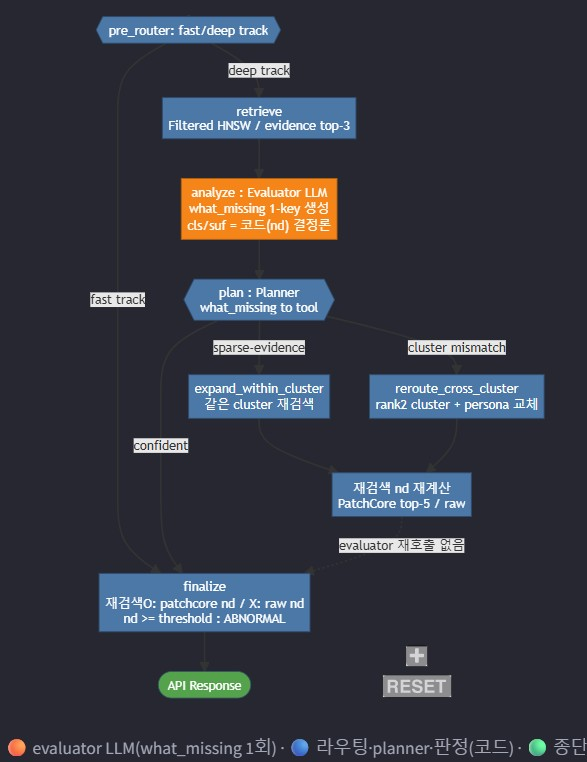
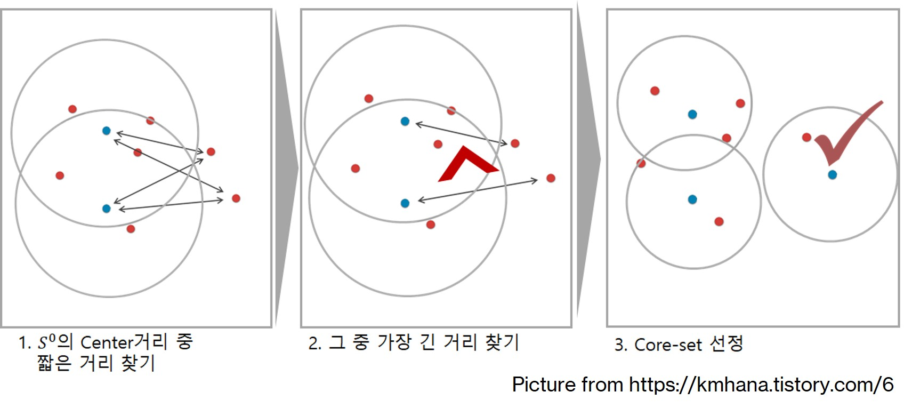
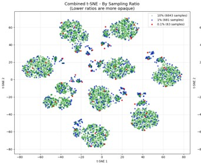
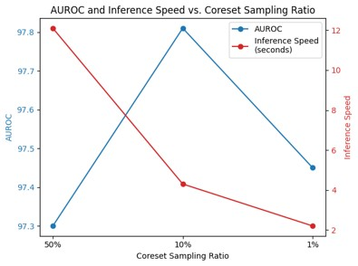
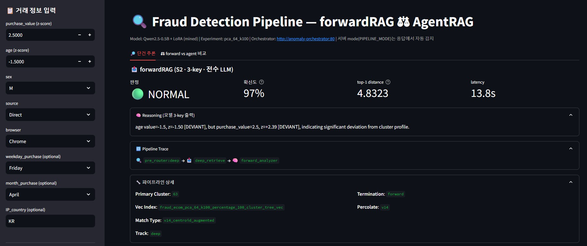
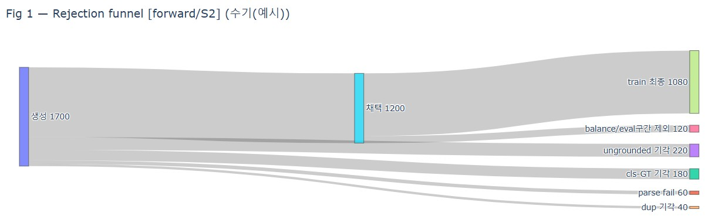
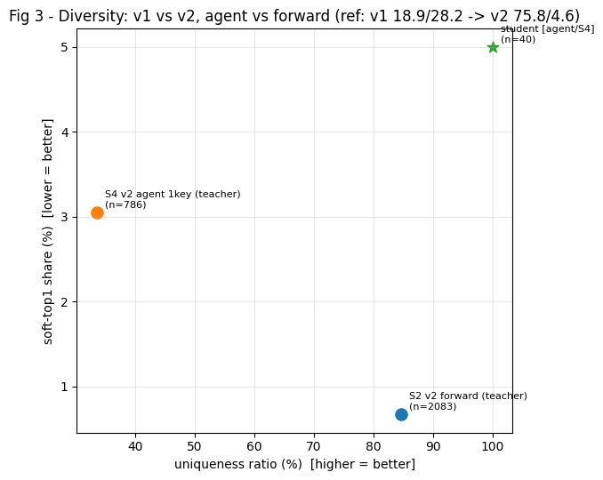
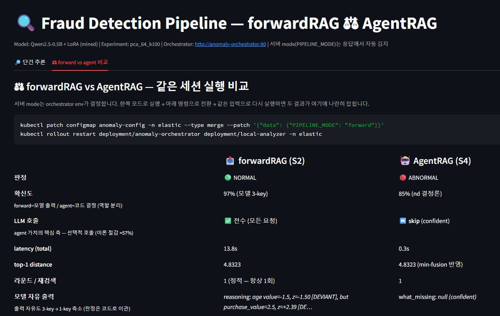

# Fraud Detection AgentRAG Pipeline

<p align="center">
  
  
  
  
  
</p>

## 📌 프로젝트 개요

**Multi-Cluster Memory Bank 이상탐지 알고리즘(EAAI 2025, 공동 1저자)을 GKE 위에서 운영 가능한 AgentRAG 시스템으로 확장한 엔드투엔드 프로젝트**입니다.

Tabular 이상 거래를 `retrieval → 거리 기반 이상탐지 → 판정 근거 설명 → 선택적 재검색` 흐름으로 처리하며, Router · Retriever · Evaluator · Planner · Orchestrator를 MSA로 분리해 배포했습니다.

프로젝트는 세 단계로 진행됐고, 각 단계의 결론이 다음 단계의 설계 전제가 됩니다.

| 단계 | 질문 | 결론 |
|---|---|---|
| **1. RAG 시스템 구축** | 12만 건 memory bank를 free-tier GKE에서 어떻게 서빙하는가 | Percolate 라우팅 + Coreset 10% + BBQ 양자화 → **메모리 −89%, AUROC 손실 0.4%p** |
| **2. forwardRAG → Evaluator** | 이상 판정에 LLM을 어디까지 쓸 것인가 | 6회 독립 측정 결과 **판정 신호는 거리(nd)가 유일** → 출력 자유도 5키 → 1키, 3B → 0.5B |
| **3. Agent 시스템** | 재검색 계획에 LLM이 필요한가, 그 값어치는 얼마인가 | 전수 counterfactual 오라클(130,883 rollout)로 **상한을 먼저 측정** → 게이트는 결정론, tool 선택만 LLM |

> 세 단계 모두 **"LLM을 넣기 전에 넣을 가치가 있는지부터 측정한다"** 는 같은 방법론을 씁니다. 그 결과 두 번(Evaluator 판정, Planner 게이트)은 LLM을 빼는 쪽이 옳다는 결론이 나왔고, 그 판단 근거를 정량적으로 남긴 것이 이 프로젝트의 핵심 산출물입니다.

---

## 🏗️ 시스템 아키텍처

```text
Test Transaction
      ↓
[Router]      Percolate Query → 클러스터 매칭 (rank1=percolate, rank2~5=centroid)
      ↓
[Retriever]   Filtered HNSW (cluster-scoped, k=3) → nd_before / 이웃 evidence
      ↓
[Evaluator]   LLM 1회 — what_missing (cluster_mismatch / neighbor_insufficient / accept)
      ↓
   sufficiency = f(nd)  ── confident(60.4%) → 종료, 이후 LLM 호출 없음
      ↓ ambiguous (39.6%)
┌──────────────────────────────────────────────────────────────┐
│ [Stage A] 결정론 게이트  |nd − τ| 상위 B%           비용 0     │  ← admission control
│ [Stage B] Planner(LLM)  think → tool + feature 선택          │  ← GRPO 학습 대상
│              contextual_knn(f≤2)  |  attribute_knn(f≤2)      │
└──────────────────────────────────────────────────────────────┘
      ↓
[Orchestrator] nd_final vs τ → 최종 판정 + round_log / termination
```


`PIPELINE_MODE=forward` 전환 시 동일 인프라에서 **정적 forwardRAG baseline**(route → retrieve → analyze 1회)으로 동작합니다 — Agent의 가치를 같은 문제지에서 A/B 측정하기 위한 구조입니다.

---
---

# Part 1. RAG 시스템 구축

> 목표는 **"12만 건 memory bank를 free-tier GKE(e2, 메모리 2GB 제한)에서 P95 300ms 안에 서빙"** 입니다. 검색 축을 하나씩 sweep해 운영점을 고정하고, 그 위에서 LLM 실험을 진행했습니다. 검색이 흔들리면 이후 MCP·tool gate 측정이 전부 교란되기 때문입니다.

## 1️⃣ Percolate Query-based Cluster Routing

최근접 정상 클러스터의 매칭 정확도와 검색 속도를 위해 라우팅 쿼리를 **3단계에 걸쳐 고도화**했습니다. K-means 클러스터링 결과를 Decision Tree로 설명 가능한 규칙으로 컴파일하고, 그 규칙을 Elasticsearch Percolate Query로 등록하는 구조입니다.

#### **Version 1: Strict AND**

Decision Tree의 리프 노드 경로를 `bool.filter`의 range 조건으로 직접 변환해 정밀 매칭합니다.

```python
# 예시: feature v1 ∈ [0.8, ∞) AND v3 ∈ [-1.2, ∞) → Cluster 63
{"query": {"bool": {"filter": [
    {"range": {"v1": {"gte": 0.8}}},
    {"range": {"v3": {"gte": -1.2}}}
]}}}
```

- **의도**: Decision tree leaf를 각 클러스터의 rule로 표현해 직관적으로 매칭
- **한계**: Strict AND 다수 결합으로 Top-5 매칭 다양성이 떨어짐 (같은 클러스터 1개만 매칭)

#### **Version 2: Centroid-Augmented Diversity**

Top-1 매칭 결과에 **벡터 유사도 기반 Top-4**를 추가해 다양성을 보완합니다.

```python
top_1 = percolate_strict_and(test_vec)                       # Phase 1
top_4 = sorted(centroids, key=lambda c: 1 - cos(test_vec, c))[:4]   # Phase 2
candidates = [top_1] + top_4
```

- **의도**: Recall@5 및 Top-5 다양성 ↑
- **한계**: Strict AND 대비 검색 지연 ↑

#### **Version 3: Optimized Bucketization**

Range 조건을 **Bucket index + Term filter**로 변환해 후보군 pruning을 최적화합니다. 부동소수점 range 비교를 term filter bitset 연산으로 바꾸는 것이 목적입니다.

```python
# Ingest: v1 ≤ 0.8 → bucket_3, direction="lte"
# Query : test_vec["v1"]=0.05 → bucket_3, tolerance ±1 → terms [2,3,4]
{"bool": {"must": [
    {"percolate": {"field": "query", "document": {...}}},
    {"bool": {"should": [ ... 9개 feature ... ], "minimum_should_match": 3}}
]}}
```

- **의도**: Range 비교 → Term bitset
- **한계**: Percolate index 크기 ↑, rule 수 증가 시 지연 가능성

#### 📊 실험 결과 — Percolate query routing

| query version | Cluster acc / Recall@5 | Router MRR | Latency p99 (ms) | Recall@5 (knn) / AUROC |
| :--- | :---: | :---: | :---: | :---: |
| Strict AND (v1) | 0.816 / 0.816 | 0.941 | 420.25 | 0.786 / 0.8726 |
| **V1 + aug** | **0.823 / 0.905** | **1.00** | 430.01 | **0.956 / 0.9125** |
| V1 + aug + bucket | 0.823 / 0.897 | 0.988 | **409.25** | 0.956 / 0.9037 |

**Bucket prefilter는 기각했습니다.** 별도 튜닝 sweep(`tolerance × min_match` 4조합)에서 `routing_acc`가 0.80 → 0.34~0.42로 무너졌는데, `cand_recall@5`는 1.0을 유지했습니다. **정답 클러스터는 top-5에 계속 있는데 top-1 서열만 흔들린다** — prefilter가 후보를 거르는 게 아니라 percolate 점수 서열을 희석시킨다는 뜻입니다. `base P95`도 함께 떨어져야 정상인데 오히려 늘어난 것이 확진 근거였습니다.

## 2️⃣ Coreset Sampling — 메모리·성능·지연 운영점 도출

<table>
<tr>
<td width="50%" align="center">
<br>
<b>Coreset Sampling Algorithm</b><br><a href="https://kmhana.tistory.com/6">(from kmhana.tistory.com)</a>
</td>
<td width="50%" align="center">
<br>
<b>Cluster Distribution by sampling ratio</b> (t-SNE)
</td>
</tr>
</table>

#### 📊 실험 결과 — Coreset 비율 vs AUROC vs 지연

| Coreset % | Index (GB) | Docs | AUROC | Recall@5 | Median Latency (ms) |
| :---: | :---: | :---: | :---: | :---: | :---: |
| 100 | 2.8 | 140,128 | 0.956 | **0.956** | 125 |
| **10** | 0.31 | 14,012 | **0.952** | 0.947 | 68 |
| 1 | 0.035 | 1,401 | 0.901 | 0.882 | **52** |

<table>
<tr>
<td width="50%" valign="top">

**Page Faults (Node 메모리 2GB 제한 시)**

| Index sharding | 100% Index | 10% Index |
| :---: | :---: | :---: |
| X | 45.2 /s | 38.7 /s |
| **O** | 52.3 /s | **8.1 /s** |

> **압축의 latency 이득은 page fault가 날 때만 발현됩니다.** working set이 page cache 안에 전부 들어가면 f32도 pf=0이라 압축과 차이가 없습니다 — 이 조건을 만들기 위해 docs 노드 메모리를 의도적으로 제한했습니다.

</td>
<td width="50%" valign="top" align="center">
<br>
<i>AUROC and Inference Speed vs. Coreset Ratio</i>
</td>
</tr>
</table>

## 3️⃣ Vector Quantization · HNSW · num_candidates Sweep

검색 축을 **재적재가 필요한 것 / 쿼리 파라미터**로 나눠 sweep했습니다. 후자는 ConfigMap patch만으로 바뀌므로 운영 중 조정 가능한 레버입니다.

**Vector Quantization** — BBQ(binary quantization) + rescore oversample 조합이 f32와 **동일 AUROC(0.8711)에 working set 1/12**입니다.

| variant | quant | oversample | working set (MB) | dist AUROC | cls@0.42 acc |
|---|---|---|---:|---:|---:|
| f32 | f32 | — | 284.8 | 0.8711 | 0.76 |
| **bbq os3** | bbq_hnsw | 3 | **23.4** | **0.8711** | 0.76 |
| int8 os0 | int8_hnsw | 0 | 82.5 | 0.8599 | **0.47** |
| int8 os3 | int8_hnsw | 3 | 82.5 | 0.8711 | 0.76 |

> `int8 os0`의 `cls@0.42 acc 0.47 / FPR 1.0`이 중요한 관찰입니다. **rescore 없이 양자화 거리를 그대로 쓰면 distance 스케일이 달라져 고정 임계값이 붕괴합니다.** AUROC(순위)는 0.86으로 멀쩡한데 절대 임계 판정만 무너지는 형태라, 순위 지표만 봤으면 놓쳤을 실패입니다.

**HNSW m/ef sweep** — `m`(그래프 연결도)과 `ef_construction`(build 품질)을 3조합 비교했고, AUROC·recall이 모두 동일해 **가장 빠른 `m=16, ef=100`을 운영점으로 고정**했습니다.

**num_candidates 곡선** — 재적재가 없는 유일한 축입니다. recall이 평탄해지는 knee(200)가 운영점이며 그 이상은 latency만 냅니다.


## 4️⃣ MCP Transport 벤치마크 · 운영 관측

Router/Retriever를 **MCP tool로 표준화**하고 3가지 transport를 동일 wall-clock 구간(`mcp_transport_latency_seconds`)으로 감싸 비교했습니다.

| transport | mode | tool Δ P95 (ms) | vs direct | dist AUROC |
|---|---|---:|---:|---:|
| direct | REST | 7,889.8 | +0.0 | 0.8283 |
| mcp | HTTP wrapper | 8,186.9 | **+42.6** | 0.8283 |
| mcpnative | stdio/SSE | 8,106.1 | **+63.1** | 0.8283 |

> **AUROC가 세 행에서 동일해야 정상**입니다 — 다르면 transport가 결과를 바꾼 것이므로 버그입니다. 이 불변량을 sweep의 sanity check로 썼습니다.
>
> 다만 `tool Δ`는 `total − base_retrieve`라 **analyzer 추론 수 초가 통째로 섞여** 있어 수십 ms짜리 transport overhead를 재기엔 부적합합니다(2.7초 vs 12.5ms). 정확한 값은 Prometheus의 `mcp p95`로 봐야 하며, 이는 **지표 정의 자체가 측정 가능성을 결정한다**는 사례로 기록했습니다.

**Percolator 샤드 분산** — percolate는 등록 쿼리(5,725개)를 입력 문서에 MemoryIndex로 실행하므로 비용이 **샤드당 쿼리 수**에 비례합니다. 일반 역색인과 달리 CPU 작업이 실제로 나뉘어 near-linear로 스케일하되, **노드 CPU 코어 수까지만** 유효합니다(percolator limit 1800m ≈ 1.8코어 → 2배 부근 포화 예상).

---
---

# Part 2. forwardRAG → LLM Evaluator

> 목표는 **"이상 판정에 LLM을 어디까지 쓸 것인가"** 를 감이 아니라 단계별 측정으로 정하는 것입니다. 전수 LLM 추론(forwardRAG)에서 출발해, 학습 데이터 품질 → 역할 분리 → 모델 축소 순으로 진행했습니다.

<p align="center"><br><i>ForwardRAG streamlit UI</i></p>

## 5️⃣ Pipeline-Aware Hard Negative Mining

무작위 샘플링 대신 **파이프라인이 실제로 틀리는 지점**을 3가지 패턴으로 정의하고, 그 구간을 집중 채굴했습니다.

| 패턴 | 정의 | 왜 어려운가 |
|---|---|---|
| **Router 오배정** | percolate top-1이 GT 클러스터와 불일치 | 잘못된 memory bank와 비교하게 됨 |
| **Cross-Cluster** | GT 클러스터가 top-5 안에 있으나 top-1이 아님 | 재검색으로 복구 가능한 구간 |
| **Distance boundary** | nd가 판정 임계 근처 | 거리만으로 판정이 갈리지 않는 구간 |

이 세 패턴이 이후 Evaluator의 `what_missing` 채널(`cluster_mismatch` / `neighbor_insufficient`)과 Agent tool 설계의 직접 근거가 됩니다.

## 6️⃣ 학습 데이터 생성 — Prompt v2 + 3중 Rejection Sampling

Teacher(Qwen2.5-14B) 증류 데이터의 품질 문제를 **프롬프트와 필터를 2단계에 걸쳐 고도화**해 해결했습니다.

#### **Version 1: GT-conditioned 생성 (rejection 없음)**

```text
프롬프트: [이웃 원시 feature 덤프 ~200 tok] + [mean/std 통계표] + GROUND TRUTH: ABNORMAL
→ teacher: reasoning을 GT에 맞춰 사후 합리화(rationalization)
```

- **의도**: GT 조건화로 라벨-설명 일관성 확보
- **한계**: reason ↔ label 인과가 파괴되어 student가 관계가 아닌 **템플릿을 암기** (고유율 18.9%, 최빈 문장 점유 28.2%, confidence 평균회귀 std<10). teacher 정답률 60~65%의 오답도 그대로 학습 신호를 오염

#### **Version 2: Prompt v2 + GT-free 생성 → 3중 Rejection**

**"통계는 시스템이 계산하고, 해석만 LLM에 남긴다"** — 프롬프트에서 산술을 제거하고 blind 생성 후 코드로 거릅니다.

```text
[정적 instruction 선두 (~120 tok, KV prefix cache 대상)]
[Deviation Table]  purchase_value: z=+0.79 [ok] ...        ← z를 사전 계산 (모델 암산 제거)
[RETRIEVAL digest] top-k agrees: sex(3/3) | differs: browser(1/3) ...   ← 원시 덤프 15 tok 압축
```

| 필터 | 내용 | 해결한 실패 모드 |
|---|---|---|
| ① cls-GT | blind teacher 판정 ≠ GT → 기각 | teacher 오답(60~65%) 오염 |
| ② grounded | 인용 feature의 **사실 방향**을 코드 검증 | "인용율 71.8%"의 함정 — 정합 서술도 통과하던 문제 |
| ③ dedup cap | soft-key(40자) 키당 ≤2% | 최빈 문장 점유 붕괴 |

- **의도**: 검증 가능한 것(z, 합의)은 코드가 계산·필터 → LLM은 "표에서 골라 서술"만
- **한계**: grounded 기각 ~38%의 수율 비용 (oversample ×1.7~2.5로 상쇄)

#### 📊 실험 결과 — 학습 데이터 품질

| 지표 | v1 (GT-conditioned) | **v2 (+Rejection)** | 목표 |
|---|---:|---:|---:|
| reasoning 고유율 | 18.9% | **75.8%** | >40% |
| top-1 문장 점유율 | 28.2% | **4.6%** | <10% |
| confidence ↔ \|nd−0.5\| 상관 | — | **0.985** | ≈1.0 |
| ECE (라벨 함수) | — | **0.109** | 서빙 비교 기준선 |

<table>
<tr>
<td width="50%" align="center">
<br>
<b>Rejection Funnel (Sankey)</b><br>생성 → parse/GT/grounded/dup 기각 → train
</td>
<td width="50%" align="center">
<br>
<b>다양성 산점 (고유율 × soft-top1)</b><br>v1 → v2 개선 + student 붕괴점 대비
</td>
</tr>
</table>

## 7️⃣ Deterministic–LLM 역할 분리 — 출력 자유도 5키 → 1키

**"어디까지 LLM에 맡길 것인가"를 단계별 실험(S1→S4)으로 측정해 축소**했습니다.

#### **Version 1: 3-key Evaluator (cls · sufficiency · what_missing 전부 LLM)**

ambiguous 구간(nd ∈ [0.3, 0.55))에서는 nd가 신뢰 불가하므로 LLM이 evidence로 cls까지 판정하게 하는 설계였습니다.

- **한계**: 데이터는 완벽(coupling 위반 0/995)했으나 **0.5B가 판정과 서술을 동시에 못 합니다**

| SUF_BALANCE A/B | nd→cls 유지 | wm 품질(P1) | 판정 |
|---|---:|---:|---|
| ambiguous만 학습 (224) | **53.8%** ❌ | 92.7% | 판정 붕괴 |
| 전 밴드 학습 (1,014) | 94.7% | **79.6%** | 서술 희석 |

#### **Version 2: 1-key + Deterministic 판정 (최종 채택)**

```python
sufficiency  = "ambiguous" if 0.3 <= nd < 0.55 else "confident"   # 코드
cls          = "ABNORMAL"  if nd >= 0.5 else "NORMAL"             # 코드
what_missing = LLM(prompt + "[SYSTEM-COMPUTED] sufficiency=...")  # 유일한 LLM 자유 출력
```

| 신호 | 담당 | 근거 (실측) |
|---|---|---|
| sufficiency | 코드 (nd-band 주입) | 이산 판정의 SFT collapse — 주입 후 wm 생성 타이밍 11% → **100%** |
| cls | 코드 (nd threshold) | ambiguous에서도 student(0.703) < nd(0.791), **net gain −14** |
| confidence | 코드 (50+50·tanh 재라벨) | teacher 자체 conf는 평균회귀 (std<10) |
| what_missing | **LLM** (감사 주석) | 실제 이탈 feature 지목 정합도 70% |

- **의도**: "표에서 골라 서술" 과제로 격하 → **3B를 0.5B로 대체**하는 근거. instruction은 서빙과 verbatim 동일(train-serve 정합)
- **한계**: wm의 판정 기여는 기각 — 가치는 감사 주석 + 선택적 호출로 재정의

#### 📊 실험 결과 — 역할 분리 (Step 0 직접 검정, eval n=300 / ambiguous 158)

| 측정 | 실측 | 판정 |
|---|---:|---|
| nd AUROC (ambiguous 밴드 내) | **0.832** | 밴드 안에서도 nd가 강신호 |
| student cls acc vs nd acc | 0.703 vs **0.791** | evidence < nd |
| net gain (student가 nd를 이긴 순증) | **−14** | ⛔ LLM 판정 개입은 손해 → deterministic 전환 확정 |

## 8️⃣ Evaluator GRPO — 검증 가능 reward와 실패 진단

SFT는 토큰 우도를 최적화해 **템플릿 암기를 보상**합니다. grounding을 직접 밀어올리기 위해 전 항이 **코드로 검증 가능한** reward를 설계했고, 두 번의 실패를 진단해 수정했습니다.

| 항 | 정의 | 검증 방식 |
|---|---|---|
| R_direction | 결함 채널(cm/ni) ↔ 결정론 신호(DEVIANT 존재 / spread) 일관성 | 프롬프트 파싱 |
| R_grounded | 인용 feature 실재 + z/value 명시 + 채널 정합 | Deviation Table |
| R_format | `"<direction>: <evidence>"` 형식 | 정규식 |
| − P_template/length/dist | 그룹 내 중복 · 토큰 초과 · 거리 재진술 | dedup key / tokenizer |

#### 실패 진단 체인 — reward는 "지형"이다

| 버전 | 실행 결과 | 진단된 원인 | 수정 |
|---|---|---|---|
| **v4** | 전 스텝 skip (updated 0/786) | reward 최상단이 cls를 요구 — 1-key 출력엔 cls가 없음 → 전 생성 0점 → **그룹 분산 0** | cls 검사를 forward 분기로 이동 |
| **v5** | 학습은 됐으나 **P1 0%**, direction 단독 출력만 (cm:ni 57:39 flip) | ① direction 단독 = 0.375 **안전지대** ② mining-GT 방향 맞히기가 최대 분산원 ③ dup 페널티가 direction-flip을 "다양성"으로 보상 — 전형적 **reward hacking** | v6 ladder |
| **v6** | *재실험 예정* | — | 무출력 0 < direction 단독 0.10 < evidence 시도 0.30 < 실인용 0.50 < 채널 정합 0.75 < +z 0.90 < +일관성 1.0 — **모든 계단에 gradient** |

> **GRPO는 정책이 실제 샘플한 출력만 학습합니다.** 붕괴 모델은 temperature 1.1 / G=8 / prefix-forcing으로 **탐색을 먼저 복원**해야 ladder가 작동합니다. 이 진단 과정 자체가 RL 디버깅의 핵심 산출물입니다.

## 9️⃣ 평가 체계 — 우선순위 지표 + LLM-as-Judge

"통과하기 쉬운 지표(인용율·loss)"가 아니라 **사실 정합을 우선 채점**합니다.

`P1` grounded-consistency → `P2` teacher-parity(Jaccard) → `P3` ECE/형식 → `P4` 다양성 → `P5` cls acc(det 서빙에선 참고). Judge는 자유출력만 이산 rubric(0/0.5/1)으로 채점하며, **신뢰성 3종(GT 상관·재현성·순서편향) 통과가 채택 조건**입니다.

| 지표 (배포 후보 0.5B GGUF Q4, n=100) | 실측 | 해석 |
|---|---:|---|
| P1 grounded-consistency | **88.0%** | 인용 feature의 사실 정합 |
| P3 confidence ECE | **0.099** | 라벨 함수 상한(0.109)에 근접 = 재라벨 학습 성공 |
| P4 고유율 / soft-top1 | 100% / 2.7% | 붕괴 없음 |
| P5 cls acc / FNR | 0.773 / 0.250 | FNR은 threshold 직교 레버 |

---
---

# Part 3. Agent 시스템 구축

> 목표는 **"검색 결과가 부족할 때 재검색을 계획하는 agent"** 입니다. Part 2에서 "판정에 LLM은 손해"라는 결론이 나왔으므로, agent의 가치를 **정확도가 아니라 선택적 호출과 계획 품질**에서 찾아야 했습니다.

<p align="center"><br><i>AgentRAG vs forwardRAG streamlit UI</i></p>

## 🔟 Planner 설계 — 전수 counterfactual 오라클로 상한 먼저 측정

Planner에 LLM을 넣기 전에 **"넣을 가치가 있는가"를 먼저 측정**했습니다. action space가 닫혀 있어(`tool 2종 × feature 조합 ≤2`) **전수 counterfactual 오라클**을 만들 수 있었습니다 — 2,830 state × 46 후보 = **130,883 rollout, 158분**.

그래서 "RL이 도달 가능한 상한의 몇 %를 회수했는가"를 직접 측정합니다. 문서검색 agent 연구가 tool별 전수 실행이 불가능해 못 하는 측정입니다.

### A. Reward 커널 — 어디에 gradient를 줄 것인가

`nd`가 `dnd`만큼 움직였을 때의 반응으로 보면 네 커널은 **gradient의 지지집합**이 다릅니다.

| 커널 | 미분 형태 | EVPI | 여지>0 | 게이트 probe (RF vs nd단독) |
|---|---|---:|---:|---|
| `R_margin` | `(2y−1)·1·dnd` — 균등 | +0.0357 | 30.3% | 0.702 vs 0.697 (+0.005) |
| **`R_flip`** | `(2y−1)·δ(nd−τ)·dnd` — τ에 Dirac | +0.0854 | 9.0% | 0.747 vs 0.681 (**+0.066**) |
| `R_resolve` | band 경계에 Dirac | +0.1228 | 12.5% | 0.700 vs 0.642 (+0.058) |
| `R_auroc` | 반대라벨 밀도 가중 | +0.0448 | 23.9% | 0.748 vs 0.813 (**−0.065**) |

**`R_flip` 채택** — 게이트 probe 격차가 유일하게 유의미하게 양수입니다. `R_auroc`은 격차가 음수, 즉 **스칼라 임계값 하나가 25-feature RF보다 낫다 = LLM이 불필요하다**는 결론이 나오는 커널입니다. **어떤 reward를 고르느냐가 아키텍처 결론을 바꿉니다.**

**하이브리드 보정** — `R_flip`은 `{−1,0,+1}` 이산이라 flip 가능 state(9%) 밖에서 모든 후보가 동점입니다(동률 99.6%). 연속 성분을 섞어 지지집합을 넓혔습니다.

```
R = R_flip + α·R_margin    (α = 2.5, flip ±1이 margin 최대 ±0.2를 5배 압도)
→ 동률 99.6% → 64.2%,  EVPI +0.13 → +0.24
```

### B. Turn 수 — λ_turn 유도로 1-turn 확정

`λ*`(검색할까 말까의 가격)와 같은 원리로 **`λ_turn`(한 번 더 할까의 가격)** 을 유도했습니다.

| 커널 | 1턴 최적 | 2턴 최적 | 한계이득 | λ_turn/λ* | 2턴 우세 state |
|---|---:|---:|---:|---:|---:|
| `R_margin` | +0.0242 | +0.0242 | +0.0000 | 0.00× | 23.4% |
| `R_auroc` | +0.0377 | +0.0551 | +0.0174 | 0.57× | 19.1% |
| `R_resolve` | +0.1007 | +0.1332 | +0.0325 | 0.44× | 3.3% |
| **`R_flip`** | **+0.0873** | **+0.0905** | **+0.0032** | **0.06×** | **0.3%** (9/2,830) |

**`MAX_ROUND=1` 확정.** "복잡해서 1턴"이 아니라 **2턴의 한계이득이 1턴의 6%로 측정됐기 때문**입니다. 이산 커널일수록 1턴에 결판난다는 구조적 관찰이기도 합니다(margin 23.4% → flip 0.3%).

### C. 비용 — reward 스칼라화 대신 admission control

`stop`을 action space에 넣으면 라벨이 91% `stop`으로 편중되고(SFT eval 100% stop), 빼면 `−λ·n_calls`가 그룹 내 상수가 되어 **advantage에서 완전히 소거**됩니다(`mean_cost 0.14` 100 step 고정). λ 튜닝으로 풀리지 않는 구조입니다.

```
maximize E[gain]   s.t.  E[cost] ≤ B      ← 라그랑주 스칼라화가 아니라 제약으로
Stage A: |nd − τ| 랭킹 상위 B%            ← 예산은 운영 파라미터
Stage B: 그 예산 안에서 gain만 최적화      ← LLM
```

**근거 3가지** — ① λ 스칼라화는 파레토 곡선의 한 점만 주는데 운영 예산은 SLA/트래픽에 따라 바뀝니다 ② `nd` 단독 게이트 AUC 0.68~0.82 vs **LLM 게이트 0.443/0.463/0.481(3회 독립 실행 전부 무정보 이하)** ③ 비용 축을 분리하면 예산 곡선 전체를 보고할 수 있습니다.

비용 단위는 latency(ms)가 아니라 **호출 수**입니다 — 실측 latency(contextual 3,677ms vs global 722ms)가 손으로 찍은 cost(1.2 vs 1.5)와 **역전**돼 있었고, 인덱스·구현 변경마다 바뀝니다.

### D. 제약 디코딩 — format penalty를 구조적으로 제거

`{"think":"[` 까지 강제 → think 자유(28 tok) → `","action":...` 부터 오라클 후보 trie. **집합 밖 출력이 생성 자체로 불가능**해집니다.

| | 무제약 | 제약 |
|---|---:|---:|
| parse rate | 5.6% | **98.5~99.1%** |
| achieved | −0.00186 | **+0.01401** (학습 0회) |

### 📊 실험 결과 — 3축 비교 (동일 eval set n=337)

| 축 | achieved | regret | parse | 해석 |
|---|---:|---:|---:|---|
| ① base + 제약 | +0.01401 | 0.190 | 99.1% | 제약만으로 얻은 것 (학습 0회) |
| ①' base 무제약 | −0.00186 | 0.206 | 5.6% | 제약 없으면 붕괴 |
| **② GRPO** | **+0.03127** | **0.173** | 98.5% | 학습 순이득 **+0.01725** |
| ③ oracle 상한 | +0.20428 | 0.000 | 100% | 상한 대비 **15.3%** 달성 |

**학습 가능성 사전 검정** — GBDT/RF는 표 데이터에서 0.5B LLM보다 강하므로, 이들이 majority를 못 넘으면 학습이 무의미합니다. 학습 전 게이트로 씁니다.

| | majority | tree d=3 | RF-300 | leakage gap |
|---|---:|---:|---:|---:|
| 오라클 라벨 | 0.570 | **0.632** | 0.588 | −0.000 |

### E. think — LLM 정당성의 직접 증거

출력이 `43-way 선택`이면 원리적으로 분류기로 환원되어 0.5B를 쓸 이유가 없습니다. `think`를 붙여 **"모델이 evidence를 읽는가"** 를 측정 가능하게 만들었습니다.

| | v5-a (구체 예시 제시) | v5-b (`[` 강제) |
|---|---:|---:|
| 태그 인용 | 10.8% | **41.7%** |
| **없는 태그 지어냄** | **89.2%** | **0.8%** |
| grounded (태그 ∧ 필드 언급) | 6.7% | 21.7% |

> **🔧 정정** — 프롬프트에 진단-처방 힌트(`cluster_mismatch → attribute_knn`)를 명시했더니 모델이 83.5%로 따랐으나 **오라클 정합률은 61.2%(우연 수준)** 였고, 그 결과 `grounded=True` 케이스의 achieved가 오히려 낮았습니다(−0.168 vs +0.035). **설계 가설을 프롬프트로 주입하면 모델이 그 가설의 오류까지 학습합니다.**

## 1️⃣1️⃣ Tool 설계 — sparse 축 도입과 정량적 실패 진단

`contextual_knn`(dense pool 확장 + soft rerank)과 `attribute_knn`(exact term filter)을 **서로 다른 정보축**으로 설계했습니다. 전자는 `neighbor_insufficient`, 후자는 `cluster_mismatch`를 겨냥합니다.

**이론적 임계** — contextual pool 크기 `P`, 반환 수 `k`, 필터 선택도 `s = support/N`일 때

```
P·s ≥ k  →  contextual이 이미 필터 일치 top-k를 pool 안에 갖고 있음 → 두 tool 동일
임계 s* = k/P = 5/25 = 0.20  →  support* ≈ 24,600
```

**실측이 예측과 일치**합니다.

| support | n | Jaccard(attr, global) | flip_rate |
|---|---:|---:|---:|
| <1k | 165 | **0.32** | 0.156 |
| 1k–10k | 4,310 | **0.29** | 0.077 |
| 10k–25k | 7,499 | 0.48 | 0.096 |
| ≥25k | 9,586 | 0.58~0.68 | 0.12 |

저선택도 구간에서는 **이질 축이 실증**되지만, **후보의 45%가 support ≥ 25,000** 입니다. candidate feature 조합이 전부 고선택도라 그 구간에 도달하지 못합니다.

| 진단 | 값 | 의미 |
|---|---:|---|
| `Jaccard(contextual, attribute)` | 0.905 | 같은 이웃을 가져옴 |
| attribute 순기여 (EVPI) | +0.0088 (3.4%) | 빼도 상한이 거의 안 변함 |
| base logprob 차이 | 0.031 | 모델은 두 tool을 동등하게 봄 |

> **원인은 tool 설계가 아니라 임베딩입니다.** AnoLLM 임베딩이 categorical feature를 이미 인코딩하고 있어, **같은 인덱스 안에서는 어떤 필터도 새 축이 되지 못합니다.** 코퍼스를 바꾸는 tool(사기 memory bank 조회 등)이 남은 탈출구입니다.

## 1️⃣2️⃣ 서빙 평가 — 결과 산출 포맷

세 산출물이 자동 생성됩니다. **아래 수치는 planner v2(Gemini) 시점 스모크(n=20)이며, v3 GRPO planner 서빙 후 교체 예정**입니다.

#### (1) `results.md` — 컴포넌트 ablation (planner 무관 축)

```
T1-A  Percolate      | variant | cand_recall@5 | routing_acc | MRR | P95(ms) | dist AUROC |
T1-B  Coreset        | coreset | docs | store(MB) | dist AUROC | recall@5 adj | ε-recall |
T1-C  Quantization   | variant | quant | oversample | working set(MB) | dist AUROC | cls@0.42 |
T2-D  HNSW sweep     | m | ef_c | segs | recall@5 | base P95 |
T3-F  MCP transport  | transport | tool Δ P95 | vs direct | dist AUROC |
T1-D  재검색 인과분해 | run | AUROC pre→post | rescued | degraded | net_gain | dir_acc |
```

`T1-D`가 planner 교체의 직접 비교축입니다 — v2에서 `net_gain −2~−6`, `dir_acc 0.48~0.57`로 **재검색이 순손실**이었고, 이것이 Part 3 재설계의 출발점입니다.

#### (2) `agent_eval_report.json` — 서빙 배치 추론 집계

```jsonc
{
  "run_id", "pipeline_mode", "n_total",
  "threshold_info":   { "auroc", "best_threshold", "best_fpr/tpr/fnr", "youden_j" },
  "agent_nd_dual":    { "n_researched", "cls_nd_threshold", "agent_nd_auroc_all" },
  "research_effect":  { "auroc": {"pre","post","delta"},
                        "by_view": {"fixed": {"overall": {"TP","FP","TN","FN","FNR","FPR"}}} },
  "planner_policy":   { "action_distribution", "search_rate", "gate_rate", "gate_reasons",
                        "planner_latency_ms": {"p50","p95"}, "output_tokens", "mean_cost" },
  "evidence_novelty": { "mean_jaccard_round0_final", "mean_novelty",
                        "cross_cluster_escape_rate", "mean_support", "jaccard_by_action" },
  "budget_curve":     [ { "budget", "n_search", "accuracy", "delta_vs_no_search" } ],
  "verdict_change":   { "n_changed", "verdict_change_rate", "correct_flip_n", "wrong_flip_n" },
  "latency_breakdown":{ "base_retrieve_ms", "total_ms" },
  "agent_summary":    { "distance_auroc", "anomaly_auroc", "research_net_gain", "agent_rag_fnr/fpr" }
}
```

**v3에서 핵심으로 볼 4개 블록**

| 블록 | 무엇을 답하는가 | v2 스모크 (n=20) |
|---|---|---|
| `budget_curve` | **§10-C의 예산 곡선** — LLM 호출 B%로 상한의 몇 %를 얻는가 | B=0% acc 0.65 → B=20% **0.75** (Δ+0.10) |
| `planner_policy` | tool 분포 / 게이트 발동 / p50·p95 latency | `attribute 0.75 / stop 0.25`, gate 25%, p50 **10.3s** |
| `evidence_novelty` | **재검색이 실제로 새 근거를 가져왔는가** | v2 미계측(`null`) — v3에서 채워짐 |
| `verdict_change` | 판정이 바뀐 비율과 방향 | 13.3% 변경, **correct_flip 2/2** |

> `evidence_novelty`가 v3의 신규 축입니다. outcome(`flip`)과 **검색 품질(novelty)** 을 분리 보고해야 "검색 개선 → 탐지 개선"의 인과를 주장할 수 있습니다.

#### (3) `agent_predictions.json` — 건별 trace

```jsonc
{ "classification", "confidence", "final_verdict", "primary_cluster_id", "top_5_clusters",
  "planner_used", "agent_trace", "agent_rounds", "termination",
  "_nd_round0", "_nd_final", "_nd_n_rounds", "_researched", "_wm_type",
  "retrieved_original_indices", "latency_ms" }
```

`_nd_round0 → _nd_final` 변화와 `retrieved_original_indices`가 있어 **오프라인에서 novelty/escape를 재계산**할 수 있습니다(재수집 불필요).

---
---

## 📎 부록 — 데이터 직접 검증 (Intuition)

설계 결정의 근거가 된 원데이터 실험 (모델 불필요).

**A-1. 신호 융합 천장 (boundary n=11,440)** — "거리가 유일 신호"의 실측

| 신호 | AUROC | 판정 |
|---|---:|---|
| top5_spread / persona_dev 단독 | 0.403 / 0.496 | 무신호 |
| **nd only** → **nd + std(top3)** | 0.779 → **0.857 (Δ+0.077)** | spread 가치는 **코드 융합**에서만 — LLM 재진술 활용 0% |
| + persona | 0.873 (Δ+0.016) | 정제 천장 닫힘 → 판별 확대는 새 차원(graph)으로만 |

**A-2. nd 통제 후 feature별 추가 정보량** — categorical 6종 전부 partial corr **+0.000** / AUROC 0.500. numeric도 partial −0.10대(nd에 흡수) → `cluster_mismatch` 근거를 numeric으로 한정한 설계의 실증.

**A-3. misroute 가설 기각** — "배정 클러스터에서 크게 벗어나면 배정이 틀렸다": max|z| AUROC **0.421**(재측정 0.514) — 오배정 샘플의 이탈이 오히려 작음. ambiguous 중 clean 59~77%로 "ambiguous ⟺ 검색 결함" 전제도 붕괴.

**A-4. reroute 재정렬 진단 (n=28,302)** — 전체는 재정렬 성격(Spearman 0.653)이나 **boundary에서 순위 보존이 깨지며(0.102) min-fusion Δ+0.062** → nd min-fusion 서빙 반영의 직접 근거.

**A-5. 지표 착시 2건 (정직한 기록)** — ① "evidence-GT 100%"는 rejection이 정답만 남긴 **순환논증**(무필터 Step 0에서 net −14로 반전) ② P1 100%도 rejection 생존자의 성질. 평가는 반드시 **무필터 eval set**에서.

---

## 🗂 의사결정 기록 (채택 / 정정 / 기각)

### Part 1 — RAG

| 결정 | 근거 |
|---|---|
| ❌ Bucket prefilter | `routing_acc` 0.80→0.34, `cand_recall@5` 1.0 유지 — 후보가 아니라 **점수 서열이 희석**됨 |
| ❌ int8 + oversample 0 | AUROC 0.86으로 멀쩡한데 `cls@τ acc 0.47 / FPR 1.0` — **rescore 없으면 절대 임계 판정이 붕괴** |
| ✅ Coreset 10% + BBQ os3 | 메모리 −89% / working set 1/12, AUROC 손실 0.4%p 이내 |
| ✅ HNSW `m=16, ef=100` 고정 | 3조합 AUROC 동일 → 최속 운영점. 검색이 흔들리면 이후 측정이 교란됨 |

### Part 2 — Evaluator

| 결정 | 근거 |
|---|---|
| ❌ Teacher rationalization (GT-conditioned) | reason↔label 인과 파괴 → GT-free 생성 + 필터 |
| ❌ 인용율을 품질 지표로 | 정합 서술도 통과 → grounded-consistency로 교체 |
| ❌ categorical을 `cluster_mismatch` 근거로 | partial corr +0.000 (부록 A-2) |
| ❌ eval_loss 기반 best-checkpoint | 템플릿 암기 보상 → P1 기반 early-stop |
| **🔧 정정** "ambiguous cls = evidence 판정" | **순환논증** — rejection이 정답만 잔존. 무필터 net −14로 반전 → cls 전면 deterministic |
| **🔧 정정** "GRPO AUROC +2.3%p" | v4 무효(cls-gate 버그) → v5 무효(안전지대 + hacking, P1 0%) → v6 ladder 재실험 |
| ✅ 출력 자유도 5→1키 + 0.5B 전환 | 판정·진단은 코드, 서술만 LLM — S1→S4 측정의 귀결 |

### Part 3 — Agent

| 결정 | 근거 |
|---|---|
| ❌ Planner에 `stop` 포함 (flat action space) | 라벨 91% stop 편중 → SFT argmax 붕괴, GRPO 게이트 AUC 0.443~0.481 **3회 연속 무정보 이하** → 2-stage 분리 |
| ❌ 비용을 reward에 λ 스칼라화 | `−λ·n_calls`가 그룹 상수 → advantage에서 소거. λ 튜닝으로 불가 → **admission control** |
| ❌ latency(ms)를 cost 단위로 | 실측(3,677 / 722ms)이 손으로 찍은 값(1.2 / 1.5)과 **역전** → 호출 수로 통일 |
| ❌ `R_auroc` 커널 | probe 격차 −0.065 — 스칼라 임계값이 25-feature RF보다 나음 = LLM 불필요 결론이 나오는 커널 |
| ❌ 2-turn 확장 | 2턴 우세 0.3%(9/2,830) — 이산 커널에서 판정은 1턴에 결판 |
| **🔧 정정** 진단-처방 힌트 주입 | 모델 정합률 83.5%인데 오라클은 61.2%(우연) → `grounded=True`의 achieved가 오히려 낮음. **가설을 주입하면 오류까지 학습** |
| **🔧 정정** `attribute_knn` = 이질 축 | 저선택도에서만 Jaccard 0.29. 후보 45%가 임계 위 → 순기여 EVPI의 3.4%. **임베딩이 categorical을 이미 인코딩** |
| ✅ `R_flip + 2.5·R_margin` | Dirac 커널의 좁은 지지집합을 균등 성분으로 확장 — 동률 99.6%→64.2% |
| ✅ 제약 디코딩 (think 자유 + JSON trie) | parse 5.6%→98.5%, format penalty가 구조적으로 발생 불가 |

> **일관된 결론** — 이 도메인에서 판정 신호는 임베딩 거리(nd)가 유일하며, LLM의 판정·게이트 개입은 순손실입니다. 따라서 LLM의 역할을 **감사 주석(what_missing)과 tool·feature 선택**으로 좁히고, agent의 가치를 "정확도 개선"이 아니라 **선택적 호출에 의한 비용 절감(호출량 100% → ≈43%)과 계획 품질**로 재정의했습니다.

---

## 🔜 남은 작업

- [ ] **Planner v3 서빙 교체** — GRPO adapter → GGUF Q8 → `local_planner` 배포 → §12 결과 실측 교체
- [ ] 진단-처방 힌트 제거 후 재실험 — `grounded × achieved` 부호 확인 (§10-E)
- [ ] `evidence_novelty` 실측 — 재검색 novelty/escape/support를 outcome과 분리 보고
- [ ] tool 축 재설계 — 같은 인덱스 내 필터로는 새 축이 안 나옴(§11) → 코퍼스를 바꾸는 tool 타당성 측정
- [ ] Evaluator GRPO v6 ladder 재실험 → §8 표 기입
- [ ] Locust 부하 3단계(light/medium/heavy) 실행 → Prometheus 지표와 교차 검증
- [ ] Prometheus `mcp p95` 실측 — §4의 `tool Δ`는 analyzer 추론이 섞여 transport overhead를 못 잼
- [ ] 하위 10% split 오라클로 EVPI 전이성 검증 (현재 상한은 상위 10% in-sample)

---

## 💻 기술 스택 & 실행

**Infra** GKE(e2), Elasticsearch 8.x(ECK), GCS, Artifact Registry, Prometheus + Grafana, Locust
**ML** Qwen2.5(0.5B/3B/14B), PEFT/LoRA, TRL(GRPO), llama-cpp-python(GGUF)
**Serving** FastAPI, LangGraph StateGraph, MCP wrapper
**Eval** Colab L4, Streamlit

```bash
# 모드 전환 (agent ↔ forwardRAG baseline)
kubectl patch configmap anomaly-config -n elastic --type merge \
  --patch '{"data": {"PIPELINE_MODE": "forward"}}'
kubectl rollout restart deployment/anomaly-orchestrator deployment/local-analyzer -n elastic

# 평가 (고정 eval set — 버전/모드 간 동일 문제지)
python evaluation/agent_eval/agent_batch_inference.py \
    --eval-source eval_set --n-samples 100 \
    --gcs-upload gs://fraud_ecomm/evaluation/agent-eval
```

```
apps/          # router, retriever, local_analyzer, controller, orchestrator, local_planner
common/        # config, prompts(학습·서빙 단일 소스), judge
evaluation/    # agent_eval, gt_loader, hard_negative_miner, oracle_rollout_batch
k8s/           # configmap 매니페스트 + batch jobs (sweep, oracle)
notebooks/     # NB01(생성) → NB02(Evaluator SFT·GRPO) → NB02b(Planner GRPO) → NB03(검증·Judge)
```

## 📚 참조

- Multi-Cluster Memory Bank 이상탐지 (EAAI 2025, 공동 1저자) — 알고리즘 기반
- PatchCore (CVPR 2022) — Coreset sampling
- Elasticsearch Percolate Query / HNSW / BBQ, LangGraph, MCP
