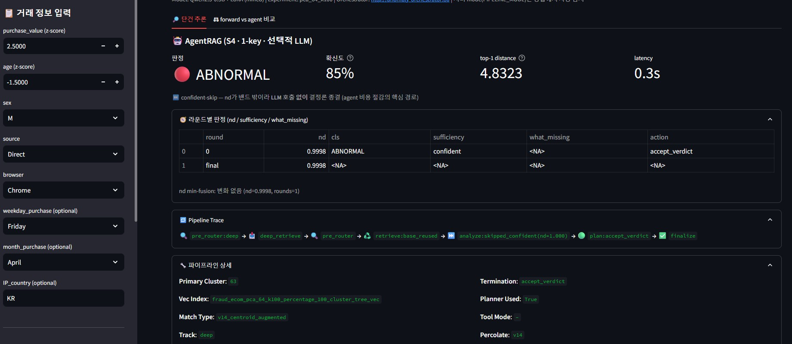

# Fraud Detection AgentRAG Pipeline

<p align="center">
  
  
  
  
  
</p>

## 📌 프로젝트 개요

**Multi-Cluster Memory Bank 이상탐지 알고리즘(EAAI 2025)을 운영 가능한 수준의 AgentRAG 시스템으로 확장한 엔드투엔드 파이프라인 개발 프로젝트**입니다.

Tabular 이상 거래를 "retrieval → 거리 기반 이상탐지 → 판정 원인 설명" 흐름으로 처리하며, Vector Indexing · Router(클러스터 라우팅) · Retriever(HNSW) · Evaluator(LLM) · Planner · Orchestrator의 6개 MSA로 GKE에 배포했습니다. 정적 forwardRAG(전수 LLM 추론 baseline)에서 출발해, **검색 결과를 평가하고 선택적으로 재검색하는 Agent 시스템**으로 확장한 과정과 그 측정 근거가 이 프로젝트의 핵심입니다.

### 🎯 핵심 문제 해결 (검증 완료 지표)

| 문제 | 해결 방안 | 성과 |
|------|---------|------|
| 벡터 검색 병목 | Percolate Query Bucketization (3단계 고도화) | Router Recall@5 +9%p, P99 latency −25% |
| 메모리 제약 | Coreset Sampling 10% 운영점 | 메모리 −89% (2.8GB→0.31GB), AUROC 손실 0.4%p 이내, median latency −46% |
| Teacher 오답이 학습 신호 오염 | Rejection Sampling (GT-free 생성 → GT 필터) | teacher 정답률 60~65% 감안 ×1.7 oversample로 품질·수량 동시 확보 |
| SFT-GRPO Training으로 llm 역할 분배 | 과제 설계 원인 정량 규명 → Deterministic-LLM 역할 분리 | what_missing 생성 타이밍 11%→100%, 실제 이탈 feature 지목 정합도 70% |
| Deterministic-planner 역할 분담 | 측정 기반 Selective Tool Gate (rule search) | expand 발동 84%→10~12%, 게이트 영역 내 good/bad flip 3.2:1 |

---

## 🏗️ 시스템 아키텍처

```text
Test Transaction
      ↓
[Router]     Percolate Query → 클러스터 매칭 (rank1=percolate, rank2~5=centroid score)
      ↓
[Retriever]  Filtered HNSW → 거리 신호 top-5 / LLM evidence top-3
      ↓
[Controller] LangGraph StateGraph — Evaluator(LLM) → Selective Tool Gate → Planner
      │         ├─ confident            → accept
      │         ├─ mismatch 신호        → reroute_cross_cluster (rank2 클러스터 + persona 교체)
      │         └─ expand rule 충족     → expand_within_cluster (evidence 3→5)
      ↓
[Orchestrator] 최종 판정 + round_log/termination → API Response
```


`PIPELINE_MODE=forward` 전환 시 동일 인프라에서 **정적 forwardRAG baseline**([route]→[Retrieve]→[Analyzer] 1회)으로 동작합니다 — Agent 시스템의 가치를 같은 문제지에서 A/B 측정하기 위한 구조입니다.

---

## 🔬 핵심 기술 (Core Technologies)

### 1️⃣ Percolate Query-based Cluster Routing

최근접 정상 클러스터의 매칭 정확도 및 검색 속도 개선을 위해, 라우팅 쿼리를 **3단계에 걸쳐 고도화**했습니다.

---

#### **Version 1: Strict AND**

Decision Tree의 리프 노드 경로를 `bool.filter`의 range 조건으로 직접 변환하여 정밀 매칭합니다.

```python
# 예시: feature v1 ∈ [0.8, ∞) AND v3 ∈ [-1.2, ∞) → Cluster 63
{
  "query": {
    "bool": {
      "filter": [
        {"range": {"v1": {"gte": 0.8}}},
        {"range": {"v3": {"gte": -1.2}}}
      ]
    }
  }
}
```

- **의도**: Decision tree의 leaf 정보를 각 클러스터의 rules로 표현하고, 이를 직관적으로 percolate query로 매칭 
- **한계**: Strict AND 다수 결합으로 인해, Top-5 클러스터 매칭의 다양성이 떨어짐 (같은 1개의 클러스터만 매칭)

---

#### **Version 2: Centroid-Augmented Diversity**

Version1의 Top-1 매칭 결과에 **벡터 유사도 기반 Top-4 클러스터**를 추가하여 다양성을 보완합니다.

```python
# Phase 1: Strict AND로 Top-1 확보
top_1 = percolate_strict_and(test_vec)

# Phase 2: Centroid cosine distance로 Top-4 보완
top_4_nearest = sorted(
    cluster_centroids, 
    key=lambda c: 1 - cosine_similarity(test_vec, c)
)[:4]

# 최종 Top-5
candidates = [top_1] + top_4_nearest
```

- **의도**: Recall@5 및 Top-5 매칭 다양성 ↑
- **한계**: Strict AND에 비해 검색 지연 ↑

---

#### **Version 3: Optimized Bucketization**

Range 조건을 **Bucket index + Term filter**로 변환하여 후보군 pruning을 최적화합니다.

````python
# 1. Ingest: Range → Bucket index
split_points["v1"] = [-2.5, -1.0, 0.0, 1.0, 2.5]
# Rule: v1 ≤ 0.8 → bucket_3, direction="lte"

# 2. Query: Test vector → Candidate buckets
test_vec["v1"] = 0.05  # → bucket_3
tolerance = ±1         # → [2, 3, 4]
````

##### **최종 Query 구조**

````python
{
  "bool": {
    "must": [
      # 기존 percolate (range 매칭)
      {"percolate": {"field": "query", "document": {...}}},
      
      # Bucket pre-filter (term 매칭)
      {
        "bool": {
          "should": [
            # v1 feature
            {
              "must": [
                {"term": {"v1_direction": "lte"}},
                {"terms": {"v1_bucket": [2, 3, 4]}}
              ]
            },
            # ... 총 9개 features
          ],
          "minimum_should_match": 3  # 9개 중 3개
        }
      }
    ]
  }
}
````

- **의도**: Range 부동소수점 비교 → Term filter bitset 연산
- **한계**: Percolate query index ↑ 및 rules 수가 늘어났을때의 검색 지연 가능성

---

#### 📊 실험 결과 (Percoalte query routing)

Percolate query version에 따른 클러스터 정확도, 리콜, 단건 검색 지연 시간 및 AUROC 지표를 비교합니다.

| query version | Cluster acc / Recall@5 (Router) | Router MRR | Latency p99 (ms) |  Recall@5 (knn) / AUROC |
| :--- | :---: | :---: | :---: | :---: |
| **Strict AND (v1)** | 0.816 / 0.816 | 0.941 | 420.25 | 0.786 / 0.8726 |
| **V1 + aug** | **0.823 / 0.905** | **1.00** | 430.01 | **0.956 / 0.9125** |
| **V1 + aug + bucket** | 0.823 / 0.897 | 0.988 | **409.25** | 0.956 / 0.9037 |

---

### 2️⃣ Filtered KNN (Coreset Sampling 검증)
Coreset Sampling 최적 운영점 검증: 메모리-이상탐지 성능-검색 latency trade-off 분석을 통해, coreset sampling 비율 10%의 최적점을 도출하고자 하였습니다.

<table>
<tr>
<td width="50%" align="center">


**Coreset Sampling Algorithm**<br>[(from https://kmhana.tistory.com/6)](https://kmhana.tistory.com/6)

</td>
<td width="50%" align="center">


**Cluster Distribution with coreset sampling ratio**<br>(t-SNE)

</td>
</tr>
</table>

---

#### 📊 실험 결과 (Coreset Sampling 검증)

**Croreset Sampling 비율 vs AUROC vs 검색 지연**

| Coreset % | Index Size (GB) | Docs Count | AUROC | Recall@5 (knn) | Median Latency (ms) |
| :---: | :---: | :---: | :---: | :---: | :---: |
| 100 | 2.8 | 140,128 | 0.956 | **0.956** | 125 |
| **10** | 0.31 | 14,012 | **0.952** | 0.947 | 68 |
| 1 | 0.035 | 1,401 | 0.901 | 0.882 | **52** |

<table>
<tr>
<td width="50%" valign="top">

**Coreset Sampling 유무에 따른 Page Faults 발생 정도**<br>
*(Memory 2GB로 Node 제한 시)*

| Index sharding | 100% Index<br>(Page Faults/sec) | 10% Index<br>(Page Faults/sec) |
| :---: | :---: | :---: |
| **X** | 45.2 | 38.7 |
| **O** | 52.3 | **8.1** |

</td>
<td width="50%" valign="top" align="center">


<p align="center"><i>AUROC and Inference Speed vs. Coreset Sampling Ratio</i></p>

</td>
</tr>
</table>

<br>

---

### 3️⃣ 학습 데이터 생성 — Prompt v2 + 3중 Rejection Sampling

Teacher(Qwen2.5-14B) 증류 데이터의 품질 문제를 **프롬프트와 필터를 2단계에 걸쳐 고도화**해 해결했습니다.
<p align="center"><br><i>AgentRAG streamlit UI</i></p>

<p align="center"><br><i>ForwardRAG streamlit UI</i></p>
---

#### **Version 1: GT-conditioned 생성 (rejection 없음)**

Teacher에게 GT를 알려주고 사후 설명을 생성하는 직관적 방식입니다.

```text
프롬프트: [이웃 원시 feature 덤프 ~200 tok] + [mean/std 통계표] + GROUND TRUTH: ABNORMAL
→ teacher: "reasoning을 GT에 맞춰 사후 합리화(rationalization)"
```

- **의도**: GT 조건화로 라벨-설명 일관성 확보
- **한계**: reason↔label 인과 파괴 — student가 관계가 아닌 **템플릿을 암기** (reasoning 고유율 18.9%, 최빈 문장 점유 28.2%, confidence 평균회귀 std<10). teacher 정답률 60~65%의 오답도 그대로 학습 신호 오염

---

#### **Version 2: Prompt v2 + GT-free 생성 → 3중 Rejection**

"통계는 시스템이 계산하고, 해석만 LLM에 남긴다" — 프롬프트에서 산술을 제거하고, blind 생성 후 코드로 거릅니다.

```text
[정적 instruction 선두 (~120 tok, KV prefix cache 대상)]
[Deviation Table]  purchase_value: z=+0.79 [ok] ...   ← z를 사전 계산 (모델 암산 제거)
[RETRIEVAL digest] top-k agrees: sex(3/3) | differs: browser(1/3) ...  ← 원시 덤프 15 tok 압축
```

| 필터 | 내용 | 해결한 실패 모드 |
|---|---|---|
| ① cls-GT | blind teacher 판정 ≠ GT → 기각 | teacher 오답(60~65%) 오염 |
| ② grounded | 인용 feature의 **사실 방향**을 코드 검증 | "인용율 71.8%"의 함정 — 정합 서술도 통과하던 문제 |
| ③ dedup cap | soft-key(40자) 키당 ≤2% | 최빈 문장 점유 붕괴 |

- **의도**: 검증 가능한 것(z, 합의)은 코드가 계산·필터 → LLM은 "표에서 골라 서술"만
- **한계**: grounded 기각 ~38%의 수율 비용 (oversample ×1.7~2.5로 상쇄) + rejection이 만드는 지표 착시(부록 참조)

---

#### 📊 실험 결과 (학습 데이터 생성)

| 지표 | v1 (GT-conditioned) | **v2 (+Rejection)** | 목표 |
|---|---:|---:|---:|
| reasoning 고유율 | 18.9% | **75.8%** | >40% |
| top-1 문장 점유율 | 28.2% | **4.6%** | <10% |
| confidence ↔ \|nd−0.5\| 상관 | — | **0.985** | ≈1.0 |
| ECE (라벨 함수) | — | **0.109** | 서빙 비교 기준선 |

<table>
<tr>
<td width="50%" align="center">


**Rejection Funnel (Sankey)**<br>생성 → parse/GT/grounded/dup 기각 → train 최종

</td>
<td width="50%" align="center">


**다양성 산점 (고유율 × soft-top1)**<br>v1 → v2 개선 + student 붕괴점 대비

</td>
</tr>
</table>

---

### 4️⃣ Deterministic–LLM 역할 분리 — Agent Evaluator 출력 자유도 5키 → 1키

"어디까지 LLM에 맡길 것인가"를 감이 아니라 **단계별 실험(S1→S4)으로 측정해 축소**했습니다.

---

#### **Version 1: 3-key Evaluator (cls·sufficiency·what_missing 전부 LLM)**

ambiguous 구간(nd∈[0.3, 0.55))에서는 nd가 신뢰 불가하므로, LLM이 evidence로 cls까지 판정하게 합니다.

- **의도**: 검색 결과가 애매할 때 LLM evidence 판정으로 nd를 보완
- **한계**: 데이터는 완벽(coupling 위반 0/995)했으나 **0.5B가 판정과 서술을 동시에 못 함** — 아래 A/B에서 해소 불가 트레이드오프 확인

| SUF_BALANCE A/B | nd→cls 유지 | wm 품질(P1) | 판정 |
|---|---:|---:|---|
| ambiguous만 학습 (224) | **53.8%** ❌ | 92.7% | 판정 붕괴 |
| 전 밴드 학습 (1,014) | 94.7% | **79.6%** | 서술 희석 |

---

#### **Version 2: 1-key + Deterministic 판정 (최종 채택)**

판정·게이트를 전부 코드로 이관하고, LLM에는 자유 출력 1개만 남깁니다.

```python
sufficiency = "ambiguous" if 0.3 <= nd < 0.55 else "confident"   # 코드 (nd-band)
cls         = "ABNORMAL"  if nd >= 0.5 else "NORMAL"             # 코드 (nd threshold)
what_missing = LLM(prompt + "[SYSTEM-COMPUTED] sufficiency=...") # 유일한 LLM 자유 출력
```

| 신호 | 담당 | 근거 (실측) |
|---|---|---|
| sufficiency | 코드 (nd-band 주입) | 이산 판정의 SFT collapse — 주입 후 wm 생성 타이밍 11%→**100%** |
| cls | 코드 (nd threshold) | ambiguous에서도 student(0.703) < nd(0.791), **net gain −14** |
| confidence | 코드 (50+50·tanh 재라벨) | teacher 자체 conf는 평균회귀 (std<10) |
| what_missing | **LLM** (감사 주석) | 실제 이탈 feature 지목 정합도 70% |

- **의도**: "표에서 골라 서술" 과제로 격하 → **3B를 0.5B로 대체**하는 근거. instruction은 서빙과 verbatim 동일(train-serve 정합)
- **한계**: wm의 판정 기여는 기각됨(부록 F7) — 가치는 감사 주석 + 선택적 호출로 재정의

---

#### 📊 실험 결과 (역할 분리 — Step 0 직접 검정, eval n=300 / ambiguous 158)

| 측정 | 실측 | 판정 |
|---|---:|---|
| nd AUROC (ambiguous 밴드 내) | **0.832** | 밴드 안에서도 nd가 강신호 |
| student cls acc vs nd acc | 0.703 vs **0.791** | evidence < nd |
| net gain (student가 nd를 이긴 순증) | **−14** | ⛔ LLM 판정 개입은 손해 → det 전환 확정 |

---

### 5️⃣ SFT → GRPO — 검증 가능 reward 설계 (실패 진단 3단계 포함)

SFT는 토큰 우도를 최적화해 **템플릿 암기를 보상**합니다. grounding을 직접 밀어올리기 위해 전 항이 **코드로 검증 가능한** reward를 설계했고, 실패를 2회 진단해 수정했습니다 — 이 진단 과정 자체가 RL 디버깅의 핵심 산출물입니다.

#### Reward 구성 (agent: what_missing / forward: reasoning)

| 항 | 정의 | 검증 방식 |
|---|---|---|
| R_direction | 결함 채널(cm/ni) ↔ 결정론 신호(DEVIANT 존재 / spread) 일관성 | 프롬프트 파싱 (코드) |
| R_grounded | 인용 feature 실재 + z/value 명시 + 채널 정합 | Deviation Table (코드) |
| R_format | `"<direction>: <evidence>"` / 3-key JSON | 정규식 |
| − P_template/length/dist | 그룹 내 중복 · 토큰 초과 · 거리 재진술 | dedup key / tokenizer |

#### 실패 진단 체인 — reward는 "지형"이다

| 버전 | 실행 결과 (실측) | 진단된 원인 | 수정 |
|---|---|---|---|
| **v4** | 전 스텝 skip (updated 0/786, reward 전부 0.0) | reward 최상단이 cls 요구 — 1-key(wm_only) 출력엔 cls가 없음 → 전 생성 0점 → 그룹 분산 0 | cls 검사를 forward 분기로 이동 |
| **v5** (graded) | 학습은 됐으나 **P1 0%, direction 단독 출력만** (cm:ni 57:39 flip) | ① direction 단독 = 0.375 **안전지대** ② mining-GT 방향 맞히기(Δ0.35)가 최대 분산원 ③ dup 페널티가 direction-flip을 "다양성"으로 보상 — 전형적 reward hacking | v6 ladder |
| **v6** (ladder) | *재실험 예정* | — | 무출력 0 < direction 단독 **0.10** < evidence 시도 0.30 < 실인용 0.50 < 채널 정합 0.75 < +z 0.90 < +일관성 1.0 — 모든 계단에 gradient. direction 채점은 GT가 아닌 **결정론 신호 일관성**, dup 페널티는 evidence 출력에만 |

> 병행 필요조건: GRPO는 정책이 실제 샘플한 출력만 학습한다 — 붕괴 모델은 temperature 1.1 / G=8 / colon prefix-forcing으로 **탐색을 먼저 복원**해야 ladder가 작동한다. v6로도 P1이 0%대면 같은 reward를 off-policy로 쓰는 best-of-n rejection SFT(RAFT)로 전환.

#### 📊 실험 결과 (SFT vs GRPO — 동일 eval set)

| 지표 | SFT (S4) | GRPO v5 (hacking) | GRPO v6 |
|---|---:|---:|---:|
| P1 grounded-consistency | — | **0.0%** | *추후 진행* |
| P4 고유율 / top1 | 4.0% / 97% | 3.0% / 57% (direction flip) | *추후 진행* |
| judge 평균 (0/0.5/1) | — | 0.300 (1점 0건) | *추후 진행* |

---

### 6️⃣ Agent 가치 재정의 — Selective 호출 + nd min-fusion

<p align="center"><br><i>AgentRAG streamlit UI</i></p>

4단계 측정의 귀결로 agent의 가치를 "정확도"가 아니라 **비용(호출량)과 판정 frame 선택**으로 재정의하고, 서빙에 반영했습니다.

- **Confident-skip**: nd가 밴드 밖이면 LLM 호출 자체를 생략 (cls/wm 정답이 결정론) — 호출량 100% → **≈43%** (ambiguous 비율)
- **Selective Tool Gate**: "ambiguous면 무조건 expand" 폐기 → 오프라인 rule search(N=28,302)로 `nd∈[0.48,0.60) ∧ plateau≤0.142` 도출 (good/bad flip 3.2:1) — expand 발동 84% → **10~12%**
- **nd min-fusion** (서빙 반영 완료): reroute/expand로 라운드가 늘면 최종 nd = **min(라운드별 nd)** — "가장 잘 맞는 정상 frame"이 판정 기준이라는 memory-bank 원리와 동일. 실측 근거: after_reroute(min) AUROC 전체 0.815→**0.836**, boundary 0.558→**0.620**

#### 📊 실험 결과 (Agent vs forwardRAG — 보수적 상한)

| 축 | forwardRAG (전수) | Agent (이론 상한) | 실측 |
|---|---:|---:|---:|
| 판정 AUROC | 0.832 | ≤0.857 (fusion 물리 천장 Δ+0.077) | *A/B 추후 진행* |
| LLM 호출량 | 100% | **≈43%** | *A/B 추후 진행* |
| latency/건 | 60~120s | ≈25~50s | *A/B 추후 진행* |

---

### 7️⃣ 평가 체계 — 우선순위 지표(Block 0) + LLM-as-Judge

"통과하기 쉬운 지표(인용율·loss)"가 아니라 사실 정합을 우선 채점합니다. **P1** grounded-consistency(인용의 사실 방향) → **P2** teacher-parity(Jaccard) → **P3** ECE/형식 → **P4** 다양성(soft-top1이 진짜 신호) → **P5** cls acc(det 서빙에선 참고). Judge는 자유출력 2-key(`what_missing`/`reasoning`)만 이산 rubric(0/0.5/1)으로 채점하며, **신뢰성 3종(GT 상관·재현성·순서편향) 통과가 채택 조건**입니다 (judge ≠ student — teacher 14B만).

#### 📊 실험 결과 (배포 후보 forward student — S2, GGUF Q4 CPU, Block 0 n=100)

| 지표 | 실측 | 해석 |
|---|---:|---|
| P1 grounded-consistency | **88.0%** | 인용 feature의 사실 정합 |
| P3 confidence ECE | **0.099** | 라벨 함수 상한(0.109)에 근접 = 재라벨 학습 성공 |
| P4 고유율 / soft-top1 | 100% / 2.7% | 붕괴 없음 |
| P5 cls acc / FNR | 0.773 / 0.250 | FNR은 threshold(0.5→0.42) 직교 레버 |

---

## 📎 부록 — Fraudecom 데이터 직접 검증 (Intuition)

위 설계 결정들의 근거가 된 원데이터 실험 (NB03 v3 Section 3, 모델 불필요).

**A-1. 신호 융합 천장 (boundary n=11,440)** — "거리가 유일 신호"의 실측

| 신호 | AUROC | 판정 |
|---|---:|---|
| top5_spread / persona_dev 단독 | 0.403 / 0.496 | 무신호 |
| **nd only** → **nd + std(top3)** | 0.779 → **0.857 (Δ+0.077)** | spread 가치는 **코드 융합**에서만 — LLM 재진술 활용 0% |
| + persona (useful/ALL) | 0.873 (Δ+0.016) | 정제 천장 닫힘 → 판별 확대는 graph(새 차원)로만 |

**A-2. nd 통제 후 feature별 추가 정보량** — categorical 6종 전부 partial corr **+0.000** / AUROC 0.500 → `cluster_mismatch` 근거를 numeric으로 한정한 설계의 실증. numeric(purchase_value/age)도 partial −0.10대(nd에 흡수).

**A-3. misroute 가설 기각 (F7)** — "배정 클러스터에서 크게 벗어나면 배정이 틀렸다"는 가설: max|z| AUROC **0.421**(재측정 0.514) — 오배정 샘플의 이탈이 오히려 작음. ambiguous 중 clean 59~77% — "ambiguous ⟺ 검색 결함" 전제도 붕괴. → wm의 판정 기여 기각의 결정 근거.

**A-4. reroute 재정렬 진단 (n=28,302)** — 전체는 재정렬 성격(Spearman 0.653, Δ+0.022)이나 **boundary에서 순위 보존이 깨지며(0.102) min-fusion Δ+0.062** → 6️⃣ nd min-fusion 서빙 반영의 직접 근거이자, 잔여 실험(nd_round0 vs nd_final)의 기대치.

**A-5. 지표 착시 2건 (정직한 기록)** — ① "evidence-GT 100%"는 rejection이 정답만 남긴 **순환논증**(무필터 Step 0에서 net −14로 반전) ② P1 100%(데이터)도 동어반복 — rejection 생존자의 성질. 평가는 반드시 **무필터 eval set**에서.

---

## 🗂 의사결정 기록 (채택 / 정정 / 기각)

| 결정 | 근거 |
|---|---|
| ❌ Teacher rationalization (GT-conditioned wm) | reason↔label 인과 파괴 → GT-free 생성 + 필터 |
| ❌ 인용율을 품질 지표로 | 정합 서술 통과 → grounded-consistency로 교체 |
| ❌ categorical을 cluster_mismatch 근거로 | partial corr +0.000 (부록 A-2) |
| ❌ eval_loss 기반 best-checkpoint | 템플릿 암기 보상 → P1 기반 early-stop |
| ❌ spread의 LLM 재진술 / retrieval_reliability 슬롯 | 활용 0% / 0/200 미발화 |
| ❌ Global centroid hard-anomaly gate / 단순 PatchCore reweight | precision 0.64~0.76 / FNR 0.16→0.26 순손실 |
| **🔧 정정** "ambiguous cls = evidence 판정" (evidence-GT 100%) | **순환논증** — rejection이 정답만 잔존. 무필터 Step 0 net −13/−14로 반전 → cls 전면 deterministic 전환 |
| **🔧 정정** "GRPO: AUROC +2.3%p, ECE −8%" | v4 무효(cls-gate 버그, 전 스텝 skip) → v5 무효(안전지대 + direction-flip hacking, P1 0%) → **v6 ladder reward로 재실험** (5️⃣ 진단 체인) |
| ✅ prompt v2 / deterministic sufficiency 주입 / Selective expand gate | 고유율 18.9→75.8% / wm 타이밍 11→100% / flip 3.2:1 |
| ✅ 출력 자유도 5→1키 + 0.5B 전환 | 판정·진단은 코드, 서술만 LLM — 4단계 측정의 귀결 |

> **6회 독립 측정 + 4단계(S1→S4) 실험의 일관된 결론** — 이 도메인에서 판정 신호는 임베딩 거리(nd)가 유일하며, LLM의 판정·진단 개입은 순손실이다. 따라서 LLM의 자유 출력을 5키 → 1키로 축소해 3B를 0.5B로 대체하고, **agent의 가치를 "정확도 개선"이 아닌 "선택적 호출에 의한 비용 절감(이론치 ≈57%)"과 감사 주석(what_missing)으로 재정의**했다.

## 🔜 남은 작업

- [ ] **GRPO v6(ladder) reward 재실험** — 탐색 복원(temp 1.1 / G=8 / colon prefix-forcing) 병행 → 5️⃣ 결과 표 기입, 실패 시 best-of-n rejection SFT(RAFT) 전환
- [ ] Judge 신뢰성 3종 통과 → 7️⃣ judge 표 채움 / 3B vs 0.5B 비교
- [ ] parse 84%→99% (GBNF grammar) / KV prefix cache 재측정(현 N=5에서 −9% 역효과 — 표본·캐시 적중 재점검)

## 💻 기술 스택 & 실행

**Infra**: GKE(e2), Elasticsearch 8.x(ECK), GCS, Artifact Registry, Prometheus+Grafana · **ML**: Qwen2.5(0.5B/3B/14B), PEFT/LoRA, llama-cpp-python(GGUF Q4), Gemini Flash Lite(Planner) · **Serving**: FastAPI, LangGraph, MCP wrapper · **Training/Eval**: Colab L4 (NB01-04 → NB02 → NB03), Streamlit, Locust

```bash
# 모드 전환 (agent ↔ forwardRAG baseline)
kubectl patch configmap anomaly-config -n elastic --type merge \
  --patch '{"data": {"PIPELINE_MODE": "forward"}}'
kubectl rollout restart deployment/anomaly-orchestrator deployment/local-analyzer -n elastic

# 평가 (고정 eval set — 버전/모드 간 동일 문제지)
python evaluation/agent_eval/agent_batch_inference.py \
    --eval-source eval_set --n-samples 100 \
    --gcs-upload gs://fraud_ecomm/evaluation/agent-eval
# NB03 v3 Section 2.5 마지막 블록이 stage별 결과를 gs://fraud_ecomm/evaluation/{run_tag}/에 저장
```

```
apps/          # router, retriever, local_analyzer(evaluator|forward), controller, orchestrator
common/        # config, prompts(학습·서빙 단일 소스, 1key/3key 스위치), judge(2-key rubric)
evaluation/    # agent_eval, gt_loader, hard_negative_miner + {run_tag}/ 결과 아카이브
k8s/           # configmap 매니페스트 + batch jobs
notebooks/     # NB01-04(생성, EXPERIMENT_STAGE) → NB02(SFT·GRPO) → NB03(검증·Judge·Fig)
```

## 📚 참조

- Multi-Cluster Memory Bank 이상탐지 (EAAI 2025, 공동 1저자) — 알고리즘 기반
- PatchCore (CVPR 2022) — Coreset sampling, local density reweighting
- Elasticsearch Percolate Query / HNSW, LangGraph, MCP