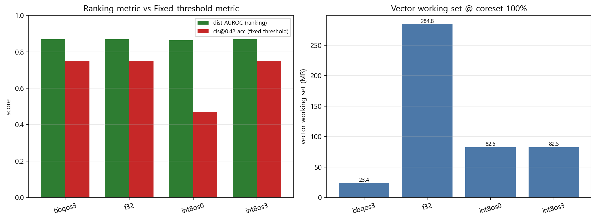
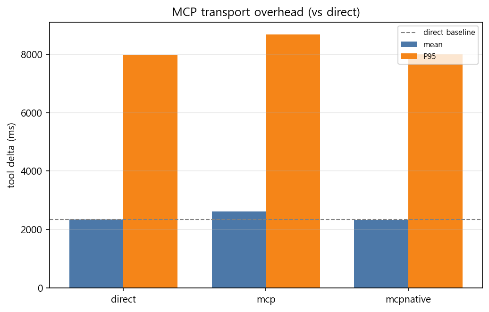
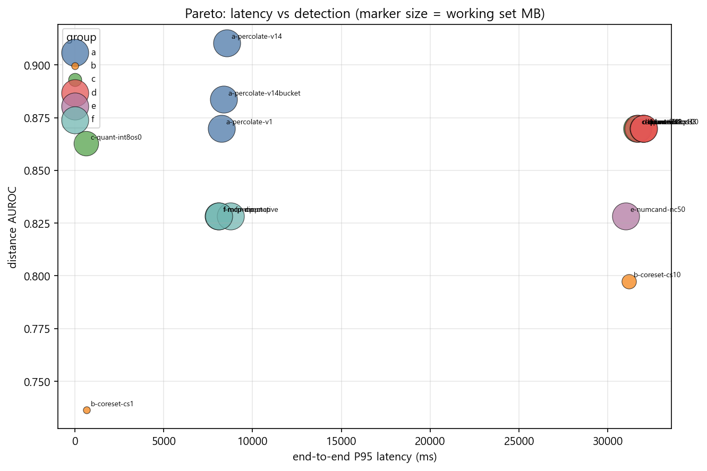
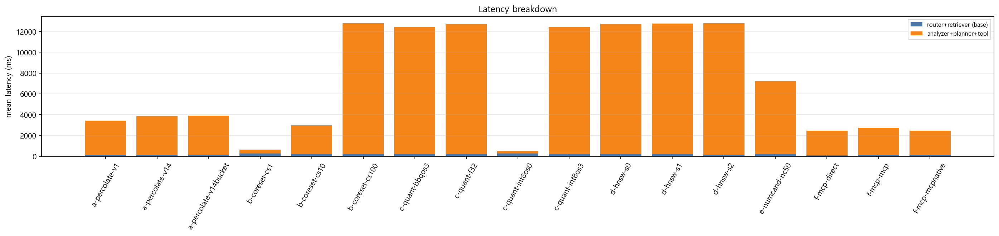

# 실험 결과 — Tier 1

- runs: **17**  ·  indices: **7**

- 제외: e-numcand-nc100(report 없음, status=unknown)

### T1-A · Percolate 최적화 (CV C1)

| variant | version | bucket | cand_recall@5 | routing_acc | MRR | recall@5 | base P95(ms) | total P95(ms) | dist AUROC |
|---|---|---|---|---|---|---|---|---|---|
| v1 | v1 | false | 0.91 | 0.8 | 1 | 0.75 | 177.3 | 8243.5 | 0.8699 |
| v14 | v14 | false | 1 | 0.8 | 0.9467 | 0.92 | 185.9 | 8547.9 | 0.9105 |
| v14bucket | v14 | true | 1 | 0.42 | 0.7214 | 0.92 | 213.8 | 8366.3 | 0.8836 |

**vs `a-percolate-v1`** — `a-percolate-v14` recall@5 +9.0%p · P95 +4.9% · `a-percolate-v14bucket` recall@5 +9.0%p · P95 +20.6%

### T1-B · Coreset 압축 (CV C2)

| coreset | docs | store(MB) | working set(MB) | dist AUROC | **recall@5 adj** | recall@5 raw | ε-recall | base mean(ms) | base P95(ms) |
|---|---|---|---|---|---|---|---|---|---|
| 1% | 1228 | 6.2 | 2.8 | 0.7363 | 0.02 | 0.02 | 0.48 | 280.7 | 429.9 |
| 10% | 12281 | 61.8 | 28.5 | 0.7973 | 0.19 | 0.19 | 0.69 | 205.8 | 323.5 |
| 100% | 122810 | 616.8 | 284.8 | 0.8699 | 0.75 | 0.75 | 0.91 | 185 | 271.1 |

**10% vs 100%** — 메모리 -90.0% · AUROC -7.26%p

> **`recall@5 adj` 를 봐야 한다.** GT top-5 는 100% 인덱스 기준이라, 10% coreset
> 에서는 진짜 top-5 가 인덱스에 존재하지 않는다. `raw` 가 떨어지는 것은 성능
> 저하가 아니라 **구조적 필연**이며, coreset 커버리지로 보정한 `adj` 만 비교 가능하다.
>
> **latency 는 이 규모에서 의미 없다.** 100% 인덱스(≈285MB working set)가 docs 노드
> page cache(≈2Gi)에 전량 상주하므로 압축해도 page fault 가 발생하지 않는다.
> coreset 의 latency 이득은 **working set 이 page cache 를 초과할 때만** 발현된다.

### T1-C · Vector Quantization (CV C3)

| variant | quant | oversample | store(MB) | working set(MB) | **dist AUROC** | recall@5 | best_thr | cls@0.42 acc | cls@0.42 FPR | mean nd |
|---|---|---|---|---|---|---|---|---|---|---|
| bbqos3 | bbq_hnsw | 3 | 627 | 23.4 | 0.8699 | 0.75 | 1.516 | 0.75 | 0.4528 | 0.643 |
| f32 | f32 | 0 | 616.8 | 284.8 | 0.8699 | 0.75 | 1.516 | 0.75 | 0.4528 | 0.643 |
| int8os0 | int8_hnsw | 0 | 684.8 | 82.5 | 0.8627 | 0.75 | 2.157 | 0.47 | 1 | 0.835 |
| int8os3 | int8_hnsw | 3 | 684.8 | 82.5 | 0.8699 | 0.75 | 1.516 | 0.75 | 0.4528 | 0.643 |

> **읽는 법**: `dist AUROC`(순위)와 `cls@0.42`(절대 임계)를 **반드시 분리해서** 본다.
> 양자화 잔차는 실제 최근접 거리와 맞먹는 크기로 **가법 상수처럼** 더해지므로
> (d_est² ≈ d_true² + ‖r‖²), 단조 변환이라 순위는 보존되고 스케일만 이동한다.
> → `int8os0`(rescore 없음)에서 **AUROC 는 유지되는데 `best_thr`/`cls@0.42` 만 무너지면**
> "거리값이 신호인 시스템에서 rescore 는 optional 이 아니라 필수"가 수치로 증명된다.

### T1-D · 재검색 인과 분해

| run | n_res | AUROC pre | post | Δ | rescued | degraded | **net_gain** | Δnd mean | **dir_acc** | amb_prec | ms/call |
|---|---|---|---|---|---|---|---|---|---|---|---|
| a-percolate-v1 | 35 | 0.8699 | 0.8699 | 0 | 0 | 0 | 0 | 0 | — | 0.1463 | 67.5 |
| a-percolate-v14 | 33 | 0.9107 | 0.9107 | 0 | 0 | 0 | 0 | 0 | — | 0.1522 | 60.6 |
| a-percolate-v14bucket | 33 | 0.8838 | 0.8838 | 0 | 0 | 0 | 0 | 0 | — | 0.1915 | 63.1 |
| b-coreset-cs1 | 1 | 0.7358 | 0.7358 | 0 | 0 | 0 | 0 | 0 | — | 0 | 59.5 |
| b-coreset-cs10 | 9 | 0.7971 | 0.7971 | 0 | 0 | 0 | 0 | 0 | — | 0.1111 | 106 |
| b-coreset-cs100 | 35 | 0.8699 | 0.8699 | 0 | 0 | 0 | 0 | 0 | — | 0.1463 | 122.7 |
| c-quant-bbqos3 | 35 | 0.8699 | 0.8699 | 0 | 0 | 0 | 0 | 0 | — | 0.1463 | 126.9 |
| c-quant-f32 | 35 | 0.8699 | 0.8699 | 0 | 0 | 0 | 0 | 0 | — | 0.1463 | 126.9 |
| c-quant-int8os0 | 1 | 0.8627 | 0.8627 | 0 | 0 | 0 | 0 | 0 | — | 0 | 53.9 |
| c-quant-int8os3 | 35 | 0.8699 | 0.8699 | 0 | 0 | 0 | 0 | 0 | — | 0.1463 | 127.9 |
| d-hnsw-s0 | 35 | 0.8699 | 0.8699 | 0 | 0 | 0 | 0 | 0 | — | 0.1463 | 131.2 |
| d-hnsw-s1 | 35 | 0.8699 | 0.8699 | 0 | 0 | 0 | 0 | 0 | — | 0.1463 | 126.2 |
| d-hnsw-s2 | 35 | 0.8699 | 0.8699 | 0 | 0 | 0 | 0 | 0 | — | 0.1463 | 167.4 |
| e-numcand-nc50 | 5 | 0.8283 | 0.8283 | 0 | 0 | 0 | 0 | 0 | — | 0 | 106.8 |
| f-mcp-direct | 5 | 0.8283 | 0.8081 | -0.0202 | 0 | 2 | -2 | 0.017 | 0.4 | 0 | 203.4 |
| f-mcp-mcp | 5 | 0.8283 | 0.8081 | -0.0202 | 0 | 2 | -2 | 0.017 | 0.4 | 0 | 412.4 |
| f-mcp-mcpnative | 5 | 0.8283 | 0.8283 | 0 | 0 | 0 | 0 | 0 | — | 0 | 76.1 |

> `net_gain = rescued − degraded`. verdict 가 하나도 안 바뀌어도
> `dir_acc`(Δnd 부호가 정답 방향인 비율)는 살아 있으므로,
> **"재검색 효과 없음"과 "효과를 측정 못 함"을 구분**할 수 있다.
> 0.5 근처면 재검색이 무작위, 0.8 이상이면 판정을 못 바꿨을 뿐 정보는 더한 것.

### T1-D-diag · 재검색 nd 갱신 진단

| run | n_res | mean|Δnd| | dir_acc | n_flip | ms/call |
|---|---|---|---|---|---|
| a-percolate-v1 | 35 | 0 | — | 0 | 67.5 |
| a-percolate-v14 | 33 | 0 | — | 0 | 60.6 |
| a-percolate-v14bucket | 33 | 0 | — | 0 | 63.1 |
| b-coreset-cs1 | 1 | 0 | — | 0 | 59.5 |
| b-coreset-cs10 | 9 | 0 | — | 0 | 106 |
| b-coreset-cs100 | 35 | 0 | — | 0 | 122.7 |
| c-quant-bbqos3 | 35 | 0 | — | 0 | 126.9 |
| c-quant-f32 | 35 | 0 | — | 0 | 126.9 |
| c-quant-int8os0 | 1 | 0 | — | 0 | 53.9 |
| c-quant-int8os3 | 35 | 0 | — | 0 | 127.9 |
| d-hnsw-s0 | 35 | 0 | — | 0 | 131.2 |
| d-hnsw-s1 | 35 | 0 | — | 0 | 126.2 |
| d-hnsw-s2 | 35 | 0 | — | 0 | 167.4 |
| e-numcand-nc50 | 5 | 0 | — | 0 | 106.8 |
| f-mcp-direct | 5 | 0.0614 | 0.4 | 2 | 203.4 |
| f-mcp-mcp | 5 | 0.0614 | 0.4 | 2 | 412.4 |
| f-mcp-mcpnative | 5 | 0 | — | 0 | 76.1 |

> `mean|Δnd| == 0` 이고 `dir_acc` 가 `—` 면 **재검색 nd 가 갱신되지 않은 것**이다
> (효과 없음이 아니라 측정 불가). 원인은 `agent_predictions.json` 의
> `agent_rounds[].patchcore_status` 로 구분된다:
> `tool_failed`(예외 삼킴) / `insufficient_neighbors`(이웃<2) / `off`(env) / `ok`(실제 무변화).

### T2-D · HNSW m/ef sweep (CV C7)

| variant | m | ef_c | store(MB) | working set(MB) | segs | dist AUROC | recall@5 | cand_recall@5 | base mean(ms) | base P95(ms) |
|---|---|---|---|---|---|---|---|---|---|---|
| s0 | 16 | 100 | 616.8 | 284.8 | 14 | 0.8699 | 0.75 | 0.91 | 196.7 | 324.6 |
| s1 | 32 | 200 | 617 | 299.8 | 15 | 0.8699 | 0.75 | 0.91 | 187.7 | 293.6 |
| s2 | 8 | 64 | 586.9 | 277.3 | 17 | 0.8699 | 0.75 | 0.91 | 183.7 | 298.4 |

> `m` 은 그래프 연결도(메모리·recall 동시 상승), `ef_construction` 은 build 품질.
> **여기서 고른 운영점을 stage 3 전체에 고정**한다 — 검색이 흔들리면
> MCP/toolgate 측정이 교란된다.

### T2-E · num_candidates 곡선

| num_candidates | dist AUROC | recall@5 | cand_recall@5 | base mean(ms) | base P95(ms) | total P95(ms) |
|---|---|---|---|---|---|---|
| 50 | 0.8283 | 0.7 | 0.9 | 221.8 | 310.1 | 31005.4 |

> **재적재 0** 인 유일한 검색 축 — 쿼리 파라미터라 ConfigMap patch 만으로 바뀐다.
> recall 이 평탄해지는 지점(knee)이 운영점이며, 그 이상은 latency 만 낸다.

### T2-I · bucket prefilter 튜닝

_(데이터 없음)_

> v14bucket 에서 `routing_acc` 0.80 → **0.25**, MRR 1.00 → 0.57 로 무너졌다.
> 그런데 `cand_recall@5` 는 1.0 유지 — **정답 클러스터는 top-5 에 계속 있는데
> top-1 서열만 흔들린다.** prefilter 가 후보를 거르는 게 아니라 percolate
> 점수 서열을 희석시킨다는 뜻이다.
> feature 9개 중 `min_match` 개만 ±`tolerance` 버킷 안에 들면 통과하므로,
> 느슨할수록 살아남는 룰이 많아진다. `t0m7`(가장 엄격)에서 routing_acc 가
> 회복되면 원인이 확정된다. `base P95` 도 함께 떨어져야 정상
> (prefilter 가 매칭 대상을 줄였다면 빨라져야 하는데 v14bucket 은 오히려 늘었다).

### T3-F · MCP transport 3-axis (CV C4)

| transport | mode | tool Δ mean(ms) | tool Δ P95(ms) | ctrl loop mean | ctrl loop P95 | **vs direct(ms)** | dist AUROC |
|---|---|---|---|---|---|---|---|
| direct | direct | 2354.2 | 7980.2 | 2353.7 | 7979.6 | +0.0 | 0.8283 |
| mcp | mcp | 2622.9 | 8665.2 | 2622.1 | 8664.2 | +268.6 | 0.8283 |
| mcpnative | mcp_native | 2331.3 | 7989.8 | 2330.8 | 7989.2 | -22.9 | 0.8283 |

> `direct` 를 기준선으로 한 **순수 transport overhead**. 세 경로 모두 동일
> wall-clock 구간(`mcp_transport_latency_seconds`)으로 감싸 측정된다.
> AUROC 가 세 행에서 동일해야 정상 — 다르면 transport 가 결과를 바꾼 것이므로 버그다.

### T3-G · conditional re-retrieval (CV C6)

_(데이터 없음)_

> CV C6 은 "FNR −4.5%p, P99 증가 +8~12% 억제" 를 주장한다.
> **off 대비 on 의 FNR 감소와 P95 증가를 같이 봐야** trade-off 가 성립한다.

### T4-H · percolator 샤드 분산

_(데이터 없음)_

> percolate 는 등록 쿼리(5,725개)를 입력 문서에 MemoryIndex 로 실행하므로
> 비용이 **샤드당 쿼리 수**에 비례한다. 일반 역색인과 달리 CPU 작업이 실제로
> 나뉘어 near-linear 로 스케일한다 — **단 노드 CPU 코어 수까지만**
> (percolator 노드 limit 1800m ≈ 1.8코어 → 2배 부근에서 포화 예상).
> `recall`/`AUROC` 는 세 행에서 동일해야 정상 — 샤딩은 결과를 바꾸지 않는다.

### T6 · 부하 3단계 (light/medium/heavy)

_(locust 결과 없음 — run_locust.sh 미실행)_

### P1 · Prometheus 메모리 병목 (page fault)

| run | quant | working set(MB) | pf p50 | pf p95 | heap% | retriever p50 | retriever p95 | top1 dist p50 |
|---|---|---|---|---|---|---|---|---|
| a-percolate-v1 | f32 | 284.8 | — | — | — | — | — | — |
| a-percolate-v14 | f32 | 284.8 | — | — | — | — | — | — |
| a-percolate-v14bucket | f32 | 284.8 | — | — | — | — | — | — |
| b-coreset-cs10 | f32 | 28.5 | — | — | — | — | — | — |
| c-quant-bbqos3 | bbq_hnsw | 23.4 | — | — | — | — | — | — |
| c-quant-f32 | f32 | 284.8 | — | — | — | — | — | — |
| c-quant-int8os0 | int8_hnsw | 82.5 | — | — | — | — | — | — |
| c-quant-int8os3 | int8_hnsw | 82.5 | — | — | — | — | — | — |
| d-hnsw-s0 | f32 | 284.8 | — | — | — | — | — | — |
| d-hnsw-s1 | f32 | 299.8 | — | — | — | — | — | — |
| d-hnsw-s2 | f32 | 277.3 | — | — | — | — | — | — |
| e-numcand-nc50 | f32 | 284.8 | — | — | — | — | — | — |
| f-mcp-direct | f32 | 284.8 | — | — | — | — | — | — |
| f-mcp-mcp | f32 | 284.8 | — | — | — | — | — | — |
| f-mcp-mcpnative | f32 | 284.8 | — | — | — | — | — | — |

> **압축의 latency 이득은 page fault 가 날 때만 발현된다.** working set 이
> docs 노드 page cache 안에 전부 들어가면 f32 도 pf=0 이라 bbq 와 차이가 없다.
> `pf p95` 가 전 행 0 이면 실험 조건이 성립하지 않은 것이다 —
> docs 노드 `resources.limits.memory` 를 낮춰 page cache 를 줄이거나
> aug 인덱스로 데이터를 키워야 한다.

### P2 · Prometheus MCP transport · TTFT/TPOT

| run | mode | mcp p50(ms) | **mcp p95(ms)** | vs direct | mcp err | TTFT p50(s) | TTFT p95(s) | TPOT p50(ms) | out tok |
|---|---|---|---|---|---|---|---|---|---|
| a-percolate-v1 | mcp_native | — | — | — | — | — | — | — | — |
| a-percolate-v14 | mcp_native | — | — | — | — | — | — | — | — |
| a-percolate-v14bucket | mcp_native | — | — | — | — | — | — | — | — |
| b-coreset-cs10 | mcp_native | — | — | — | — | — | — | — | — |
| c-quant-bbqos3 | mcp_native | — | — | — | — | — | — | — | — |
| c-quant-f32 | mcp_native | — | — | — | — | — | — | — | — |
| c-quant-int8os0 | mcp_native | — | — | — | — | — | — | — | — |
| c-quant-int8os3 | mcp_native | — | — | — | — | — | — | — | — |
| d-hnsw-s0 | mcp_native | — | — | — | — | — | — | — | — |
| d-hnsw-s1 | mcp_native | — | — | — | — | — | — | — | — |
| d-hnsw-s2 | mcp_native | — | — | — | — | — | — | — | — |
| e-numcand-nc50 | mcp_native | — | — | — | — | — | — | — | — |
| f-mcp-direct | direct | — | — | — | — | — | — | — | — |
| f-mcp-mcp | mcp | — | — | — | — | — | — | — | — |
| f-mcp-mcpnative | mcp_native | — | — | — | — | — | — | — | — |

> **`mcp p95` 가 CV C4 의 진짜 측정값이다.** T3-F 의 `tool Δ` 는
> `total − base_retrieve` 라 analyzer 추론 수 초가 통째로 섞여 있어
> 수십 ms 짜리 transport overhead 를 잴 수 없다(2.7초 vs 12.5ms).
> `mcp err > 0` 이면 그 run 의 재검색 결과는 **전부 무효**다 —
> tool 이 실패하면 patchcore nd 가 계산되지 않아 Δnd 가 0 으로 나온다.

### t3f_mcp

### t1e_pareto

### t1f_latency

